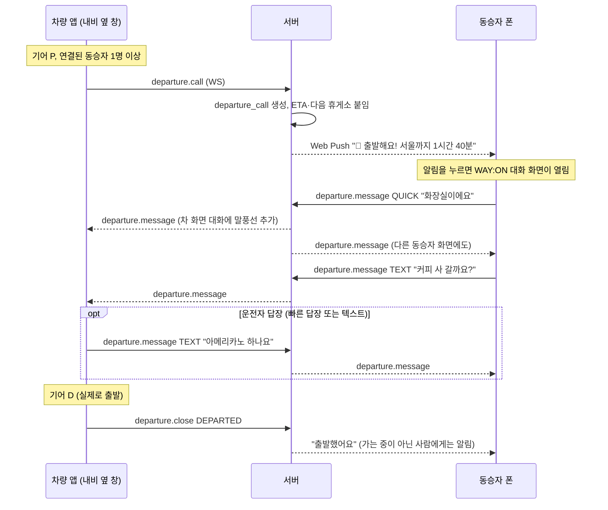

# [출발해요] 출발 알림 + 차 화면 대화 기획 (2026-11-05)

> 상태: **제안.** 11/5 협의로 "오늘 나온 아이디어까지만 반영"하기로 한 범위에 들어가는 기능입니다.
> 협의 항목은 11장 `답:` 칸을 채워 가며 정합니다.
> 관련 문서: [11/4 회의 결과](meetings/2026-11-04-회의결과.md) · [way-on.md](way-on.md) · [erd.md](erd.md)

---

## 1. 한 줄 요약

휴게소에서 운전자가 **차 화면**의 [출발해요]를 누르면 QR로 연결된 동승자 폰마다 알림이 갑니다. 알림을 누르면 WAY:ON 화면이 바로 열리고, 동승자는 [화장실이에요] [줄 서 있어요] [가는 중이에요] 중 하나를 고르거나 짧은 메시지를 써서 **차로 보냅니다.** 차 화면은 **메신저처럼 바뀌어서** 누가 무슨 말을 했는지 한눈에 보입니다.

---

## 2. 전제 (확정)

| 전제 | 내용 |
|---|---|
| **여러 명 QR 연결** | 한 차에 동승자 여러 명이 연결됩니다. 차례로 스캔하고, QR이 찍히면 서버가 새 QR로 바꿉니다 . **최대 4명** (11/5) |
| **닉네임 필수** | QR로 연결할 때 닉네임을 꼭 입력해야 연결이 끝납니다. 차 화면 대화에서 이 이름으로 보입니다 |

닉네임 규칙 (제안):
- 1~10자. 앞뒤 공백은 지움. 비워 두면 다음 단계로 못 감
- 같은 차에 연결된 동승자끼리 **겹치면 안 됨** ("민지"가 이미 있으면 "민지2" 같은 다른 이름을 넣으라고 안내)
- 자동 재연결 때는 다시 묻지 않음. 폰 화면에서 바꿀 수 있음

연결 순서: QR 스캔 → **닉네임 입력** → 위치 공유 동의 → **알림 허용** → 연결 완료

---

## 3. 왜 차에서만 시작하나 (카톡과 다른 점)

폰에서 아무나 [출발해요]를 누를 수 있으면 단톡방에 "출발~"이라고 보내는 것과 같습니다. **차에서만 시작할 수 있다는 점**이 이 기능의 차별점입니다.

| | 카톡 단톡방 | WAY:ON [출발해요] |
|---|---|---|
| 누가 시작하나 | 아무나 | **차 화면에서만** → "운전자가 차에 탔고 출발 준비가 됐다"는 뜻이 확실함 |
| 운전자 | 폰 꺼내서 잠금 풀고, 방 찾고, 입력 | 내비 옆 화면에서 버튼 한 번. 답은 **차 화면에서 바로** 봄 |
| 같이 가는 정보 | 직접 써야 함 | 남은 시간, 도착 예정 시각, 다음 휴게소까지 거리를 **자동으로 붙임** |
| 답장 | 매번 타이핑 | 버튼 하나로 [화장실이에요] [줄 서 있어요] [가는 중이에요] |
| 누가 아직인지 | 읽음 숫자만 보임 | 차 화면 위쪽에 **사람별 상태**가 늘 보임 |
| 차가 실제로 출발하면 | 아무 일 없음 | 기어 D가 되면 자동 종료. **"가는 중"이 아닌 사람에게 "차가 출발했어요"** 알림 → 사람을 두고 가는 일을 막음 |

---

## 4. 흐름



---

## 5. 알림 → 앱 열기

- 동승자 화면은 설치형 앱이 아니라 **웹**입니다. 알림은 **Web Push**(서비스 워커)로 보냅니다.
- 알림을 누르면 서비스 워커가 WAY:ON 대화 화면을 엽니다. 이미 열려 있는 탭이 있으면 그 탭을 앞으로 가져옵니다 (`notificationclick` → `clients.openWindow()` / `client.focus()`).
- 홈 화면에 추가해 두면 브라우저 주소창 없이 **앱처럼** 열립니다.
- 화면이 열리면 재연결 토큰으로 자동 연결합니다. QR을 다시 찍지 않습니다 (F5).

| 환경 | 알림 받기 | 눌렀을 때 |
|---|---|---|
| Android Chrome | 됨. 알림 권한만 받으면 됨 | 브라우저 탭 또는 홈 화면 웹 앱으로 열림 |
| iPhone Safari | **홈 화면에 추가한 웹 앱에서만** 됨 (iOS 16.4 이상) | 홈 화면 웹 앱으로 열림 |
| 페이지를 열어 둔 상태 | WebSocket으로 바로 받음 (진동·소리) | — |

알림 허용을 거절했거나 iPhone에서 홈 화면에 추가하지 않았으면 차 화면에 **"알림 꺼짐"**으로 보입니다. 운전자가 직접 전화하면 됩니다.

Web Push는 HTTPS에서만 됩니다 (개발 중 `localhost`는 예외). 배포처·도메인 결정(미정)과 엮여 있습니다.

---

## 6. 화면

### 6-1. 차 화면 — 평소 (기어 P, 동승자 연결됨)

```
┌──────────────────────────┐
│ WAY:ON                    │
│                           │
│  동승자 3명 연결됨          │
│  민지 · 준호 · 엄마         │
│                           │
│ ┌───────────────────────┐ │
│ │      🚗 출발해요        │ │  ← 큰 버튼 하나
│ └───────────────────────┘ │
│  서울까지 1시간 40분        │
└──────────────────────────┘
```

### 6-2. 차 화면 — [출발해요]를 누른 뒤 (메신저 모드)

```
┌──────────────────────────┐
│ 🚗 출발 대기 · 3분 지남     │
│ 🏃민지  🚻준호  🔕엄마      │  ← 사람별 최신 상태 (늘 위에 고정)
├──────────────────────────┤
│        출발해요! (운전자) ▷ │
│        서울까지 1시간 40분   │
│                           │
│ ◁ 준호  🚻 화장실이에요     │
│ ◁ 민지  ⏳ 줄 서 있어요     │
│ ◁ 민지  커피 사 갈까요?     │
│        천천히 와요 (운전자) ▷│
│ ◁ 민지  🏃 가는 중이에요    │
│                           │
├──────────────────────────┤
│ [천천히 와요] [빨리 와요]   │  ← 운전자 빠른 답장
│ ┌─────────────┐ [보내기]  │  ← 운전자 텍스트 (P에서만)
│ │ 메시지 입력…  │          │
│ └─────────────┘          │
│ [다시 알리기]     [취소]    │
└──────────────────────────┘
```

- 위쪽 상태 줄: 사람마다 **마지막으로 고른 빠른 답장**을 아이콘으로 보여 줍니다. 아무것도 안 보냈으면 ⚪, 알림을 못 받으면 🔕.
- 가운데: 메신저처럼 말풍선이 아래로 쌓입니다. 동승자는 왼쪽, 운전자는 오른쪽. 새 말풍선이 오면 맨 아래로 내려갑니다.
- 운전자도 **빠른 답장과 텍스트**를 둘 다 보낼 수 있습니다. 입력창을 누르면 차량 키보드가 뜹니다. 기어 P에서만 열리는 화면이라 가능합니다.
- [다시 알리기]는 아직 아무 답도 안 한 사람에게만 보냅니다. 1분에 한 번.
- 기어가 D가 되면 대화 화면을 닫고 평소 화면으로 돌아갑니다. **주행 중에는 대화 화면을 보여 주지 않습니다.**

### 6-3. 동승자 폰

알림 (폰이 잠겨 있거나 다른 앱을 쓰는 중):

```
WAY:ON
🚗 출발해요! 차로 와 주세요
서울까지 1시간 40분 · 도착 예정 15:20
```

알림을 누르면 열리는 대화 화면:

```
┌──────────────────────┐
│ 🚗 출발 대기 · 3분 지남 │
│ 🏃민지 🚻준호 ⚪엄마    │
├──────────────────────┤
│ 운전자  출발해요!        │
│        서울까지 1h 40m  │
│ 준호   🚻 화장실이에요   │
│              나 ⏳ 줄 서 있어요 │
├──────────────────────┤
│ [🚻 화장실이에요]        │
│ [⏳ 줄 서 있어요]        │
│ [🏃 가는 중이에요]       │
│ ┌──────────────┐ [보내기]│
│ │ 메시지 입력…   │       │
│ └──────────────┘       │
└──────────────────────┘
```

- 빠른 답장 3개는 크게, 메시지 입력은 그 아래에.
- 다른 동승자의 말도 같이 보입니다 (단체 대화방처럼).

---

## 7. 규칙

| 항목 | 규칙 |
|---|---|
| 버튼 보이는 조건 | 기어 P **그리고** 알림 받을 동승자가 1명 이상 |
| 동시에 진행 | 차 1대에 출발 알림 1건만. 진행 중에는 버튼 대신 대화 화면 |
| 받는 사람 | 이 차의 현재 세션 동승자. 휴게소에서 세션이 끊겼으면 직전 세션 동승자 (8장) |
| 동승자 빠른 답장 | `TOILET`(화장실이에요), `IN_LINE`(줄 서 있어요), `COMING`(가는 중이에요). 상태 줄에는 마지막 것만 |
| 동승자 메시지 | 최대 40자 (차 화면에서 한 줄~두 줄로 읽히게). 상태는 안 바뀜. 1초에 1건 넘게 못 보냄 |
| 운전자 빠른 답장 | `TAKE_TIME`(천천히 와요), `HURRY`(빨리 와요) |
| 운전자 메시지 | 동승자와 같은 규칙 (최대 40자). 기어 P에서만 입력 가능 |
| 다시 알리기 | 아직 아무것도 안 보낸 사람에게만, 1분 간격 |
| 끝나는 조건 | 기어 D(`DEPARTED`), 운전자 [취소](`CANCELLED`), 30분 지남(`EXPIRED`) |
| 출발했을 때 | `COMING`이 아닌 사람: "차가 출발했어요. 차에 타셨나요?" 알림 / `COMING`인 사람: 알림 없이 화면만 닫음 |
| 자동 정보 | 목적지까지 남은 시간·도착 예정(`onDrivingInfo`, `requestTrip()`→`onTripInfo`), 다음 휴게소(F2 계산). 목적지가 없으면 문구만 |
| 대화 보관 | **삭제하지 않음.** [출발해요]를 누를 때마다 **새 대화방**으로 시작하고, 지난 대화는 차 대화 화면의 "지난 출발 알림" 카드(같은 날짜 + 같은 동승자면 한 장)로 찾아 읽음 (2026-11-09 변경, 처음에는 지난 대화에 이어 붙이는 안이었음). **30일** 지나면 삭제 (11-3) |
| 주행 중 | 기어가 D가 되면 대화 화면을 숨김. 진행 중인 출발 알림은 닫히고, 그 뒤로는 메시지를 보낼 수 없음 (폰 입력창도 잠김) |

---

## 8. 세션 문제 — 휴게소에서 시동을 끄면

지금 설계에서는 통신 없이 5분이면 `trip`이 만료됩니다. 휴게소에서 시동을 끄고 20분 쉬면 다시 시동을 걸 때 **새 세션**이 되고, 동승자는 아직 새 세션에 붙지 않은 상태입니다. 그러면 [출발해요]를 받을 사람이 없습니다.

제안: 받는 사람을 세션이 아니라 **차량 기준**으로 정합니다.
- 받는 사람 = 현재 세션 동승자 + **이 차량의 직전 세션(끝난 지 2시간 이내)에 있던 동승자**
- 동승자가 알림을 누르면 재연결 토큰으로 **새 세션에 자동으로 붙습니다** (QR 없음)

→ 이 기능은 **F5 자동 재연결을 전제로 합니다.** 자동 재연결 여부(미정)를 "자동"으로 정할 이유가 하나 더 생깁니다.

확인 필요: 시동을 끈 동안 차량 앱이 살아 있는지, 다시 켜면 앱이 다시 뜨는지 (에뮬레이터에서는 확인 어려움 → 공모전 문의).

---

## 9. 서버·데이터

### 9-1. 테이블 (제안 — 협의 후 erd.md·schema.sql에 반영)

```
departure_call                       departure_message
- id BIGINT PK                       - id BIGINT PK
- vehicle_id BIGINT FK               - call_id BIGINT FK
- trip_id BIGINT FK                  - passenger_id BIGINT FK NULL  (NULL이면 운전자)
- status VARCHAR(10)                 - kind VARCHAR(5)  "QUICK, TEXT"
  "OPEN, DEPARTED, CANCELLED, EXPIRED" - quick_code VARCHAR(10) NULL
- eta_min SMALLINT NULL                "TOILET, IN_LINE, COMING, TAKE_TIME, HURRY"
- called_at DATETIME(3)              - body VARCHAR(40) NULL  (TEXT일 때)
- last_reminded_at DATETIME(3) NULL  - sent_at DATETIME(3)
- closed_at DATETIME(3) NULL
```

- `vehicle_id`에 `OPEN`은 1건만 (생성할 때 `FOR UPDATE`로 확인, 기존 규칙과 같음)
- 사람별 상태 = 그 사람의 마지막 `QUICK` 메시지. 아무것도 없으면 "응답 없음"
- 닫혀도 지우지 않음. 차량 앱에서 동승자를 해제해도 메시지는 남기고, 닉네임은 "(나간 동승자)"로 보여 줌. 보낸 지 **30일** 지난 메시지는 하루 1번 배치로 삭제 (11-3)

`passenger`에 푸시 구독 컬럼 추가: `push_endpoint VARCHAR(500)`, `push_p256dh VARCHAR(100)`, `push_auth VARCHAR(50)`, `push_updated_at DATETIME(3)` (전부 NULL 가능, NULL이면 "알림 꺼짐").

닉네임(2장 전제)은 이미 반영: `passenger.label` → **`passenger.nickname VARCHAR(10) NOT NULL`** (erd.md, schema.sql).

### 9-2. 메시지

| 방향 | 이름 | 내용 |
|---|---|---|
| 차 → 서버 | `departure.call` | — |
| 차 → 서버 | `departure.remind` | `callId` |
| 차 → 서버 | `departure.close` | `callId`, `reason` (`DEPARTED`, `CANCELLED`) |
| 차·폰 → 서버 | `departure.message` | `callId`, `kind`, `quickCode` 또는 `body` |
| 서버 → 차·폰 | `departure.message` | `messageId`, `callId`, `sender {passengerId 또는 DRIVER, nickname}`, `kind`, `quickCode`, `body`, `sentAt` |
| 서버 → 차·폰 | `departure.status` | `callId`, 사람별 `{passengerId, nickname, lastQuickCode, pushEnabled}` |
| 서버 → 폰 | `departure.called` | `callId`, `calledAt`, `etaMin`, `destName`, `nextRestAreaKm` (+ 같은 내용으로 Web Push) |
| 서버 → 차·폰 | `departure.closed` | `callId`, `reason` |
| 폰 → 서버 (REST) | `PUT /api/passengers/me/push-subscription` | 브라우저 구독 정보 |
| 차·폰 → 서버 (REST) | `GET /api/vehicles/me/departure-messages?before={messageId}` | 화면을 새로 열었을 때 지난 대화 불러오기 (위로 올리면 더 불러옴) |

30분 만료는 별도 스케줄러 없이 다음 `departure.call`이나 메시지가 올 때 같이 처리합니다 (waypoint 60초 만료와 같은 방식).

---

## 10. 범위

| 단계 | 내용 |
|---|---|
| **MVP** | 닉네임 필수 연결, 차 [출발해요] 버튼, Web Push(Android) + 눌러서 열기, 빠른 답장 3개 + 짧은 메시지, 차 메신저 화면(상태 줄 + 말풍선), 운전자 빠른 답장 2개 + 텍스트, 지난 대화 이어 보기, 다시 알리기, 기어 D면 자동 종료 + 알림, ETA 자동 첨부 |
| 확장 | 출발 시간 지정([5분 뒤] [10분 뒤]), 휴게소 도착 때 "15분 쉬어요" 미리 알림, 폰 위치로 "차 근처 도착" 자동 표시, 메시지 음성 읽기(TTS, SDK 공개 후), iPhone용 알림톡 |

---

## 11. 협의할 것

### 11-1. 빠른 답장 목록
- 동승자: [화장실이에요] [줄 서 있어요] [가는 중이에요] 3개. 더 넣을 것? (예: [차에 있어요], [먼저 가세요])
- 운전자: [천천히 와요] [빨리 와요] 2개로 충분한지

답: **빠른 답장 한다 (11/5).** 목록은 위 기본안 (동승자 3개, 운전자 2개)

### 11-2. 메시지 (동승자·운전자 공통)
- 자유 메시지 40자 제한 괜찮은지
- 차 화면에 그대로 보여 주므로 욕설 거르기가 필요한지 (가족·지인끼리라 MVP에서는 안 함 제안)

답:

### 11-3. 대화 보관 기간
- 대화는 삭제하지 않기로 함 (11/5). 계속 쌓을지, 기간을 둘지 (예: 30일, 또는 동승자를 해제할 때 그 사람 메시지도 삭제)

답: **30일 (11/5).** 보낸 지 30일 지난 메시지는 하루 1번 배치로 삭제

### 11-4. 출발 시간 지정
- 운전자가 [5분 뒤 출발]처럼 시간을 정할 수 있게 할지. 쓸모는 많지만 차 화면 조작이 늘어남 → 제안: 확장

답:

### 11-5. 시간 값
- 다시 알리기 간격 1분, 자동 종료 30분, 직전 세션 인정 2시간. 이대로?

답:

### 11-6. iPhone
- MVP에서 iPhone은 "홈 화면에 추가" 안내만 할지, 다른 방법(알림톡)을 찾을지

답: 대기 (11/5)

### 11-7. 기능 번호
- MVP 기능 목록에 **F8 출발 알림·대화**로 넣을지. 일정이 부족할 때 줄이는 순서에서 어디쯤 둘지

답: **F8**로 넣음 (11/5, way-on.md 8.1). 줄이는 순서는 미정

---

## 12. 확인 필요

| 항목 | 확인 방법 |
|---|---|
| 시동을 끈 동안 차량 앱 유지, 다시 켰을 때 자동 실행 여부 | 공모전 문의 |
| 기어 P/D 신호 속성명·퍼미션 | Vehicle SDK 문서 (QR 표시 조건과 같은 신호) |
| 정차 중 차 화면 대화·키보드 입력이 운전 제한 정책에 걸리는지 | 운전 제한 정책 문서 재확인. P에서만 보여 주고, "기타 지역"은 키보드도 허용이라 괜찮을 것으로 보임 |
| Web Push가 Pleos 심사·보안 가이드에 걸리는 게 없는지 | 동승자 폰 쪽이라 해당 없을 것으로 보이지만 확인 |
| `onDrivingInfo`가 정차(P) 중에도 남은 시간을 주는지 | 에뮬레이터에서 경로 설정 후 확인 |
