# WAY:ON 차량 앱 설계

> 기준 문서: [app-api.md](app-api.md) (차 ⇄ 서버 ⇄ 폰 규격). 앱 설계는 이 규격을 따르고, 폰 웹은 따로 설계한 뒤 나중에 합칩니다.
> 기능 설명은 [way-on.md](way-on.md) 3장, 출발해요는 [출발해요 기획](2026-11-05-출발해요-기획.md).
> 상태: **초안 (2026-11-05)**. 1장의 결정은 11/5 앱 설계 결정입니다.

## 목차

1. 결정 요약
2. 앱 구조
3. 앱이 기억하는 값
4. 화면
5. 화면 전환 규칙
6. 기능별 흐름
7. 백그라운드, 끊김, 실패 처리
8. 입력
9. 시연용 위치 재생
10. 사용하는 SDK와 권한
11. 기준값
12. app-api.md에 더하거나 맞출 것
13. 에뮬레이터에서 확인할 것
14. 할 일 (세팅)

---

## 1. 결정 요약

| # | 항목 | 결정 |
|---|---|---|
| 1 | 정차 중 차 화면 장소 목록 | 넣음 |
| 2 | 음성 안내 | 동승자가 없을 때만. 에너지·주차장·휴게소 접근 |
| 3 | 에너지 제안 | 주행 가능 거리 < 목적지 남은 거리 + 20km |
| 4 | 휴게소 접근 안내 | 경유지로 넣은 휴게소만, 남은 거리 2km |
| 5 | 운전자 수락 시간 | 10초 |
| 6 | 운전자 빠른 답장 | [천천히 와요] [빨리 와요] |
| 7 | 출발 시간 지정 ([5분 뒤 출발]) | 안 함 (11/5) |
| 8 | 시연용 위치 재생 | 만듦 (9장) |
| 9 | APK 이름 | `WayOn_WayOn_release.apk` (신청서 팀명 확인) |
| 10 | 요청이 겹칠 때 | 마지막 요청으로 바꿈. 10초 지나면 자동 거절 |
| 11 | 동승자 해제 | 정차 중에만, 설정 화면에서 |
| 12 | 백그라운드 통신 | 포그라운드 서비스로 유지 |
| 13 | 내비가 앞에 있을 때 요청 | 보조 창 앱 화면에 띄움. heads-up 알림이 되면 같이 씀 |
| 14 | 시동을 껐다 켰을 때 | 앱이 뜨면 자동으로 세션을 다시 엶 |
| 15 | 입력 | 터치 + CCP 다이얼 |
| 16 | 주행 중 4자리 코드 | 안 씀. 주행 중에는 자동 재연결만 |
| 17 | 연속 주행 2시간 제안 | 안 함 (11/5) |
| 18 | 주차장 알림 | 남은 거리 10km 또는 남은 시간 5분 중 먼저. 고르면 목적지를 주차장으로 바꿈 |
| 19 | 동승자가 없을 때 에너지 제안 | 정차 중에는 차 화면 목록, 주행 중에는 음성 |
| 20 | 운전자 텍스트 입력 | 기어 P일 때만 |
| 21 | 화면 목록 | 홈, QR, 요청 수락, 장소 목록, 출발해요 대화, 설정 (4장) |
| 22 | 요청 수락 화면 | 장소 이름, 종류, 요청한 사람, 남은 시간, [추가] [거절] |
| 23 | 경유지가 2개 다 찼을 때 | 거절. 폰에 "경유지가 가득 찼어요" (서버가 처리, 차로 요청이 오지 않음). 1번과 바꾸기는 없앰 |
| 24 | 경유지 추가 실패 | 차 화면에 3초 동안 "추가하지 못했어요" + 요청한 동승자에게도 알림 |
| 25 | 동승자 연결·해제 | 홈의 동승자 수만 바꿈. 주행 중 팝업 없음 |
| 26 | 오프라인 표시 | 화면 위 "연결 끊김" 띠, 다시 붙으면 자동으로 사라짐 |
| 27 | 장소 목록 종류 | 휴게소 / 주유소·충전소 / 맛집 탭. 주차장은 목적지 근처일 때만 |
| 28 | 처음 실행 | 자동으로 차량 등록, 바로 홈. 가입 없음 |
| 29 | 목적지가 없을 때 | 홈에 "내비에서 목적지를 설정해 주세요" |
| 30 | 운전자가 차 화면에서 직접 고른 장소 | 수락 화면 없이 바로 내비에 넣음. 서버에 기록하지 않고 바뀐 경로(`car.route`)만 보냄 |
| 31 | 폰 연결이 끊겼을 때의 대비 (장소 목록, 음성) | 남김. 일이 많으면 장소 목록은 휴게소 탭만, 음성은 녹음 음원 3개로 줄임 |
| — | 세션 열림 | 서버가 연결된 폰에 `trip.started`를 보냄 (app-api 그대로) |

**제외 범위 (11/5).** 나중으로 미루지 않고 뺐습니다. 이 문서는 아래를 빼고 전부 설계합니다.
- 출발 시간 지정 ([5분 뒤 출발])
- 연속 주행 2시간 휴게소 제안
- 휴게소 도착 때 "15분 쉬어요" 미리 알림
- 출발해요 메시지 음성으로 읽기
- 음성으로 수락·거절 (음성 인식)
- 스티어링 휠 버튼 입력, 주행 중 4자리 코드 연결

---

## 2. 앱 구조

화면 1개(Activity) + 포그라운드 서비스 1개로 만듭니다. 화면을 닫아도 서비스가 통신과 차량 값 읽기를 계속합니다.

### 2-1. 구조도

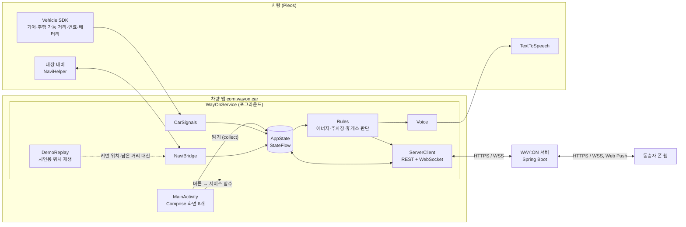

- 화살표는 값이 흐르는 방향입니다. 화면은 `AppState`를 읽기만 하고, 바꾸는 건 서비스 안쪽뿐입니다.
- 차량 앱은 폰과 직접 통신하지 않습니다. 모두 서버를 거칩니다.

### 2-2. 클래스

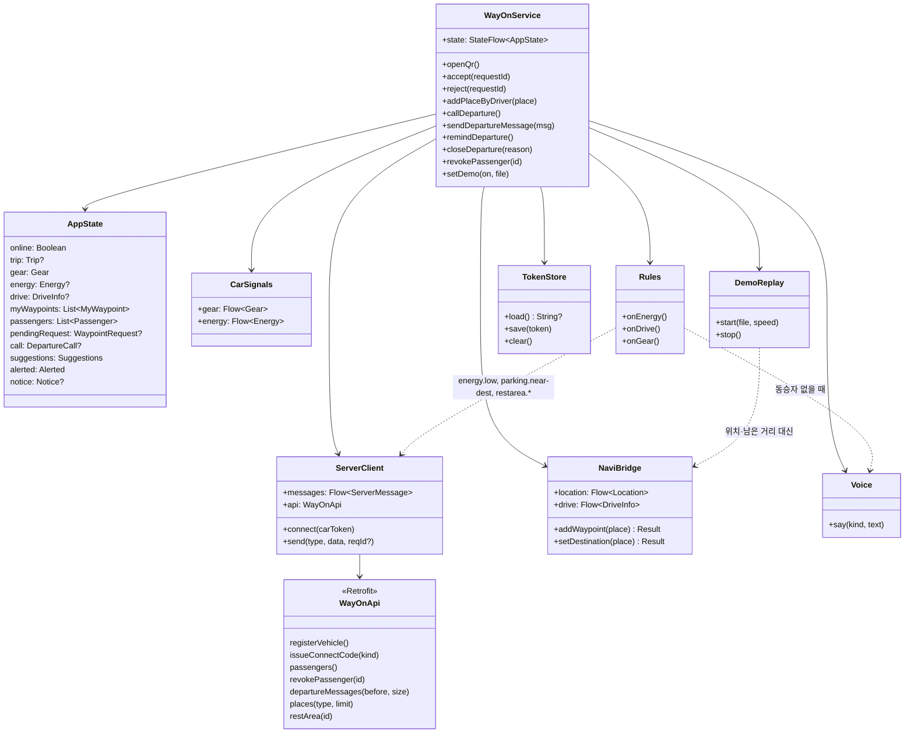

`notice`는 홈에 띄우는 한 줄 안내입니다 (권한, 토큰 다시 등록 등, 7장).

**패키지**

| 패키지 | 내용 |
|---|---|
| `com.wayon.car.ui` | 화면 6개, 공통 띠, 테마 |
| `com.wayon.car.service` | `WayOnService`, `AppState`, `Rules`, `TokenStore` |
| `com.wayon.car.server` | Retrofit API, WebSocket 연결·재접속, 메시지 모델 (app-api 5·7장) |
| `com.wayon.car.car` | `CarSignals`, `NaviBridge` (호출 방법은 10장 확인 결과와 git 기록 `3b6decf`의 `VehicleCheck.kt`, `LocationCheck.kt` 참고) |
| `com.wayon.car.voice` | `Voice` |
| `com.wayon.car.demo` | `DemoReplay` |

- 상태는 `AppState` 한 곳에서만 바꿉니다. 화면은 읽기만 하고, 버튼은 서비스의 함수를 부릅니다.
- 서버 메시지와 SDK 콜백은 모두 서비스로 들어와 `AppState`를 바꾸고, 화면은 그 값을 보고 다시 그려집니다.

---

## 3. 앱이 기억하는 값

| 값 | 내용 | 저장 위치 |
|---|---|---|
| `carToken` | 차량 토큰. 처음 실행 때 받음 | Android Keystore 키로 암호화해 파일에 저장 |
| `online` | WebSocket이 `auth.ok`까지 됐는지 | 메모리 |
| `trip` | 지금 세션 (`tripId`), 없으면 null | 메모리 |
| `gear` | `PARK` / `DRIVE` / … / `UNKNOWN` | 메모리 |
| `energy` | 종류, %, 주행 가능 거리(m) | 메모리 |
| `drive` | 목적지와 경유지의 이름·남은 거리·남은 시간 (`onDrivingInfo`) | 메모리 |
| `myWaypoints` | 우리 요청으로 넣은 경유지: `requestId`, 이름, 종류, 좌표 | 파일 (앱을 다시 켜도 `car.route`에 좌표를 넣으려고) |
| `passengers` | 등록 동승자 목록 (`passengers.update`) | 메모리 |
| `pendingRequest` | 지금 떠 있는 경유지 요청 1건 | 메모리 |
| `call` | 열린 출발 알림, 상태 줄, 대화 | 메모리 |
| `suggestions` | 서버가 보낸 에너지·주차장 제안 (동승자가 없을 때 차로 옴) | 메모리 |
| `alerted` | 이번 목적지에서 이미 보낸 것: 에너지, 주차장, 휴게소별 접근·도착 | 메모리. 목적지가 바뀌면 지움 |
| `demo` | 시연용 위치 재생 켜짐 여부, 고른 경로 파일 | 파일 |
| `locationConsent` | 차량 쪽 위치 공유 동의 여부 | 파일 |
| `notice` | 홈에 띄울 한 줄 안내 (7-3~7-5) | 메모리 |

"동승자 있음"은 `passengers` 중 `online: true`가 1명 이상일 때입니다 (way-on.md 3.11). 사람이 타고 있어도 폰을 잠갔거나 페이지를 닫았으면 "동승자 없음"이 됩니다. 차 화면 장소 목록과 음성 안내는 이때 폰 대신 알려 주는 대비책입니다.

---

## 4. 화면

보조 창(1:1 또는 2:1)에서 내비 옆에 띄우는 것을 기본으로 합니다. 큰 글자, 버튼은 한 화면에 3개 이하로 둡니다.

| 화면 | 언제 | 주행 중 |
|---|---|---|
| 홈 | 기본 | 보임 (짧은 문구만) |
| QR | 홈에서 [동승자 연결] | 숨김 → 홈 |
| 요청 수락 | `waypoint.request`가 오면 다른 화면 위에 | **보임** (DO 화면) |
| 장소 목록 | 홈에서 [주변 장소], 또는 제안이 왔을 때 | 숨김 → 홈 |
| 출발해요 대화 | [출발해요]를 누르거나 열린 출발 알림이 있을 때 | 숨김 → 홈 |
| 휴게소 지도 | 경유지로 넣은 휴게소에 도착(기어 P)하면 홈 대신 | 숨김 → 홈 (기어 D = 떠남) |
| 설정 | 홈의 ⚙ | 숨김 → 홈 |

모든 화면 위에 **오프라인 띠**를 겹칩니다 (`online`이 false일 때 "연결 끊김 · 다시 연결하는 중").

### 4-1. 홈

```
┌──────────────────────────┐
│ WAY:ON                ⚙  │
│                          │
│  동승자 2명 연결됨          │
│  민지 · 준호               │
│                          │
│  부산역까지 3시간 30분       │  ← 목적지가 없으면 "내비에서 목적지를 설정해 주세요"
│                          │
│ [🚗 출발해요]               │  ← P + 받을 동승자 1명 이상
│ [동승자 연결] [주변 장소]     │  ← P일 때만
└──────────────────────────┘
```

- 주행 중: 동승자 수, 목적지 남은 시간, 휴게소 접근 한 줄(`곧 경산(서울)휴게소`)만 보입니다. 버튼은 숨깁니다.
- 동승자가 연결되거나 끊겨도 팝업 없이 숫자와 이름만 바뀝니다.
- 차량 앱이 아직 세션을 못 열었으면(`trip` null) "연결 준비 중"을 보여 줍니다.

### 4-2. QR

```
┌──────────────────────────┐
│ ← 동승자 연결               │
│      ┌────────┐          │
│      │  QR    │          │
│      └────────┘          │
│  폰 카메라로 찍어 주세요      │
│  1:42 남음   [새로 만들기]   │
│  연결됨: 민지 (2/4)         │
└──────────────────────────┘
```

- 열 때 `POST /connect-codes {"kind": "QR"}`. 만료 3분이 지나면 자동으로 새로 받습니다 (화면이 열려 있는 동안만).
- **QR 하나로 여러 명이 연결**합니다. 동승자가 연결되면(`passengers.update`) 아래 줄에 이름만 늘고 QR은 그대로 둡니다. 4명이 차면 QR을 숨깁니다.
- 4명이면(`PASSENGER_LIMIT`) QR 대신 "동승자는 4명까지예요. 설정에서 해제할 수 있어요".
- 기어가 D가 되면 바로 닫습니다.

### 4-3. 요청 수락

```
┌──────────────────────────┐
│ 민지님의 요청      ●●●○○ 7초│
│                          │
│  🍜 경산(서울)휴게소         │
│     휴게소 · 18km 앞        │
│                          │
│  [  추가  ]   [  거절  ]   │
└──────────────────────────┘
```

- `waypoint.request`가 오면 어느 화면이든 그 위에 띄웁니다. 주행 중에도 띄우는 유일한 화면입니다.
- ~~남은 시간은 `expiresAt` 기준으로 줄어듭니다. 0이 되면 서버의 `waypoint.expired`를 기다리지 않고 닫습니다.~~
- **바뀜 (2026-11-09): 그대로 두면 자동으로 추가합니다.** 남은 시간 아래에 "그대로 두면 N초 뒤 자동으로 경유지를 추가해요"(목적지면 "목적지를 바꿔요")를 보여 주고, 10초가 되면 [추가]를 누른 것과 같이 `waypoint.accept`를 보냅니다. 운전자는 원치 않을 때만 [거절]을 누릅니다. 서버 마감은 15초 (app-api.md 5-10)
- `action`별 문구:
  - `ADD`: "경유지로 추가할까요?"
  - `SET_DEST`: "목적지를 ○○로 바꿀까요?" (주차장, 또는 목적지가 없을 때)
  - 경유지가 2개 다 찼으면 서버가 폰에서 거절하므로 차에는 오지 않습니다.
- 떠 있는 동안 새 요청이 오면 **내용을 새 요청으로 바꾸고** 시간을 다시 셉니다 (서버가 이전 것을 `EXPIRED`로 바꿈).
- [추가]를 누른 뒤 서버 `ack`를 기다리는 동안 버튼을 잠급니다.

### 4-4. 장소 목록

```
┌──────────────────────────┐
│ ← 주변 장소                 │
│ [휴게소] [주유·충전] [맛집]   │  ← 목적지 근처면 [주차장] 탭 추가
│ 경산(서울)휴게소   18km · 15분│
│ 칠곡휴게소        42km · 30분│
│ …                        │
└──────────────────────────┘
```

- 정차 중에만 열립니다. 혼자 운전할 때도 씁니다.
- 목록은 `GET /trips/current/places?type=`를 **차량 토큰으로** 부릅니다 (12장 1번).
- 주유·충전 탭은 `energy.energyType`에 맞춰 주유소 또는 충전소를 부릅니다.
- 에너지·주차장 제안이 차로 오면(동승자가 없을 때) 그 탭을 열어 둔 상태로 홈에 배지를 띄우고, 정차하면 바로 보여 줍니다.
- 항목을 누르면 상세 한 줄 + [경유지로 추가] (주차장은 [목적지로 설정]). 운전자가 직접 고른 것이라 수락 화면 없이 바로 내비에 넣고, 서버에는 바뀐 경로(`car.route`)만 보냅니다. 경유지가 2개 다 찼으면 [경유지로 추가]를 잠그고 "경유지가 가득 찼어요".
- 서버에 기록하지 않으므로 이 휴게소는 동승자 폰에 도착 안내가 가지 않습니다. 차 화면 도착 카드와 음성은 `myWaypoints`로 그대로 동작합니다 (`requestId` 없이 저장).
- 고속도로 맛집 행(`ra:`)을 누르면 그 휴게소의 Top5를 보여 줍니다.

### 4-5. 출발해요 대화

출발해요 기획 6-2 그대로입니다.

- 위: 사람별 마지막 빠른 답장 (`departure.status`).
- 가운데: 말풍선. 동승자 왼쪽, 운전자 오른쪽. 처음 열 때 `GET /departure-messages`로 지난 대화를 불러오고, 위로 올리면 더 불러옵니다.
- 아래: [천천히 와요] [빨리 와요], 텍스트 입력(40자, 기어 P에서만), [다시 알리기] [취소].
- [다시 알리기]는 누른 뒤 1분 동안 잠급니다 (`REMIND_TOO_SOON` 방지).
- 기어가 D가 되면 `departure.close {reason: DEPARTED}`를 보내고 홈으로 갑니다.

### 4-6. 설정

- 동승자 목록: 닉네임, 연결 중 여부, 알림 받는지. 각 줄에 [해제] → 확인 한 번 → `DELETE /passengers/{id}`.
- 시연용 위치 재생 켜기·끄기, 경로 파일 고르기 (9장).
- 서버 주소, 앱 버전 (개발용 표시).
- 정차 중에만 열립니다.

---

### 4-7. 휴게소 지도

휴게소에 도착하면(6-7) 홈이 이 화면으로 바뀝니다. 기어 D(떠남)면 홈으로 돌아갑니다. 정차 중에만 보이므로 지도 조작(확대·이동·누르기)을 허용합니다.

```
┌──────────────────────────────────────────────────┐
│ WAY:ON   매송(목포)휴게소                          │
├────────────────────────┬─────────────────────────┤
│ (위성 지도 + 도로·이름)   │ 🏢 매송(목포)휴게소        │
│   ☕할리스   🍽️브알라      │ 건물 안 식당가에서 파는 메뉴예요│
│      🏢 휴게소 건물      │ 식당가 인기 메뉴           │
│   (3) ← 겹친 매장 묶음    │  2위 뚝배기제육   10,500원 │
│   🏪CU    ⛽주유소       │   └ 파는 곳 양갑조국밥     │
│        ● 차 현재 위치     │ 식당가 메뉴 94개           │
│                        │  곰탕 [베스트]  10,000원   │
└────────────────────────┴─────────────────────────┘
```

- **지도** (카카오맵 JS를 웹뷰로, `assets/rest_area_map.html`): 위성 사진 + 도로·이름(`HYBRID`). 휴게소 건물과 매장들이 다 보이게 자동 확대(레벨 3까지).
  - 매장 아이콘은 **실제 위치**에: 🍽️ 음식점 ☕ 카페 🏪 편의점 ⛽ 주유소 🔌 충전소 🚻 화장실 🏧 ATM. 위치는 적재 때 카카오에서 받아 둔 `rest_area_place` (erd.md)
  - 영업 끝난 매장은 흐리게. 같은 건물이라 겹치는 아이콘은 숫자 원으로 묶고, 누르면 오른쪽에 목록
  - 🏢 휴게소 건물 마커(휴게소 좌표), 차 현재 위치(파란 점, 5초마다)
- **정보** (지도와 같은 너비, 줄 높이 64dp 이상, 구분선. 옆 줄이 같이 눌리지 않게)
  - 처음(또는 건물·빈 곳을 누르면): 식당가 인기 메뉴, 식당가 메뉴(베스트·추천 표시, 가격), 지도에 위치가 없는 매장, 편의시설
  - 메뉴 줄을 누르면 **파는 곳**이 펼쳐짐 (메뉴 이름 앞 괄호 `(유가네)곰탕` → 유가네, 판매 순위의 매장 `푸드(양갑조국밥)` → 양갑조국밥, 코너 이름이면 "식당가 한식 코너"). 그 가게가 지도에 있으면 **[지도에서 보기]** → 지도에 주황 고리와 이름으로 표시
  - 매장 아이콘을 누르면: 영업시간, 영업 중 여부, 잘 팔리는 메뉴(판매 순위, 1위는 "가장 잘 팔려요")
- 데이터는 서버 3-9(`/api/rest-areas/{코드}/map`) 한 번. 받기 전에는 "휴게소 지도를 불러오는 중", 못 받으면 "불러오지 못했어요"
- 지도 키가 없거나 지도를 못 띄우면 정보 칸만 화면 전체로 보여 줍니다
- 웹뷰는 출처 없이(기준 주소 null) 엽니다. 카카오 JS 키는 등록 안 된 웹 도메인을 막는데(`domain mismatched`) 출처가 없으면 통과합니다 (2026-11-06 확인). 키는 `car-app/local.properties`의 `KAKAO_JS_KEY` (team-setup.md)

## 5. 화면 전환 규칙

### 5-1. 화면 전환도

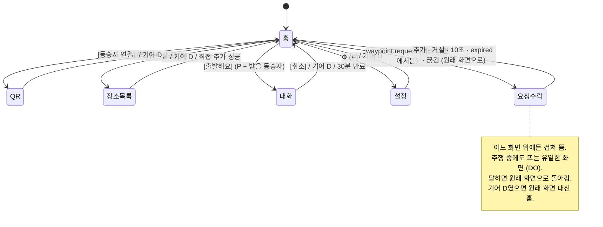

### 5-2. 우선순위

우선순위가 높은 것이 위에 옵니다.

1. **요청 수락**: 어느 화면 위에든. 닫히면 원래 화면으로.
2. **기어 D**: QR, 장소 목록, 출발해요 대화, 설정을 닫고 홈으로. 출발 알림이 열려 있으면 `DEPARTED`로 닫음.
3. **열린 출발 알림** (`auth.ok`의 `openCall`, 또는 `departure.called` 이후): 정차 중이면 대화 화면.
4. **휴게소 도착** (경유지 휴게소에서 기어 P): 홈 아래에 그 휴게소 정보(편의시설, 영업 매장, Top5) 카드와 [출발해요].
5. 그 밖에는 홈.

기어를 못 읽으면(`UNKNOWN`) 주행 중으로 봅니다. 안전한 쪽입니다.

---

## 6. 기능별 흐름

### 6-1. 처음 실행

1. `carToken`이 없으면 `POST /api/vehicles` → 받은 토큰을 저장.
2. 차량 쪽 위치 공유 동의를 한 번 받습니다 (앱 화면의 [동의] 버튼). 이어서 알림 권한을 묻습니다 (위치는 NaviHelper로 받아 FusedLocation 권한은 쓰지 않음).
3. 서비스를 시작하고 홈으로.

거부했을 때는 7-3.

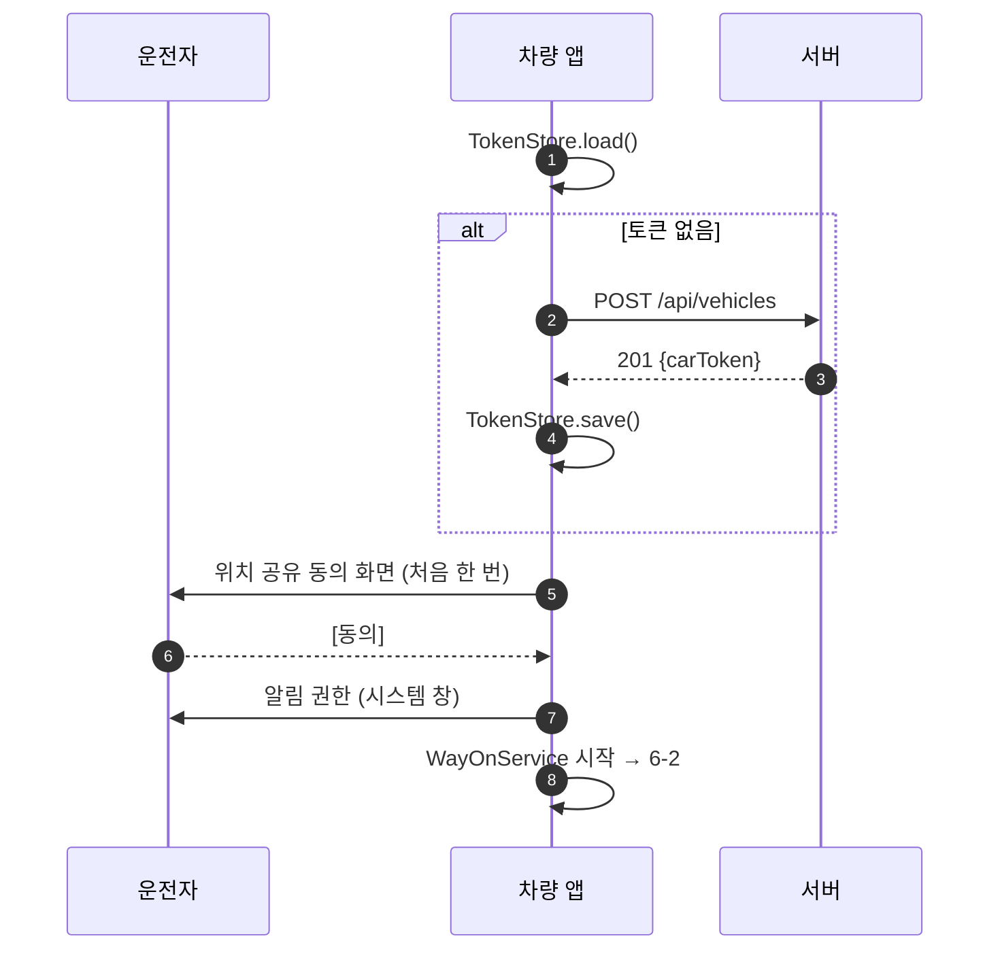

### 6-2. 앱 시작 · 세션 열기 (시동을 다시 켰을 때 포함)

1. 서비스가 WebSocket에 접속 → `auth {carToken}` → `auth.ok`.
2. `auth.ok.trip`이 null이면 바로 `trip.start {locationConsent: true}`. 이미 있으면 그 세션을 씀.
3. 서버가 연결된 폰들에 `trip.started`를 보냅니다. 토큰이 있는 동승자는 QR 없이 붙습니다.
4. 위치(5초마다), 목적지·경유지(바뀔 때), 에너지, 기어를 보내기 시작합니다.
5. `openCall`이 있으면 출발해요 대화를 다시 엽니다.

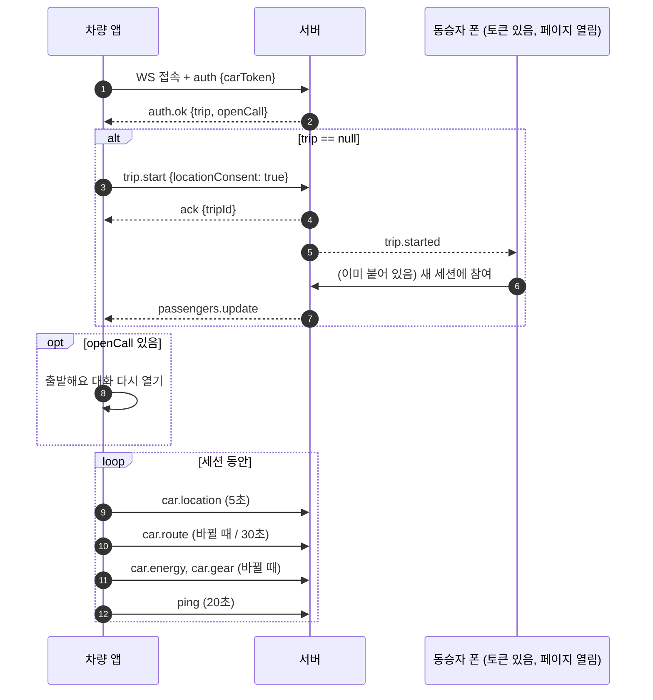

시동을 끈 동안 앱이 살아 있는지는 모릅니다 (13장). 앱이 다시 뜨기만 하면 위 순서로 복구됩니다.

### 6-3. 동승자 연결 (QR)

4-2 참고. 차량 앱이 하는 일은 코드 받기, QR 그리기, 기어 D면 닫기뿐입니다. 닉네임·동의는 폰에서 합니다.

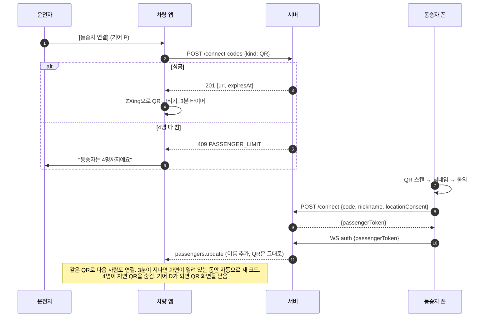

### 6-4. 경유지 요청 처리

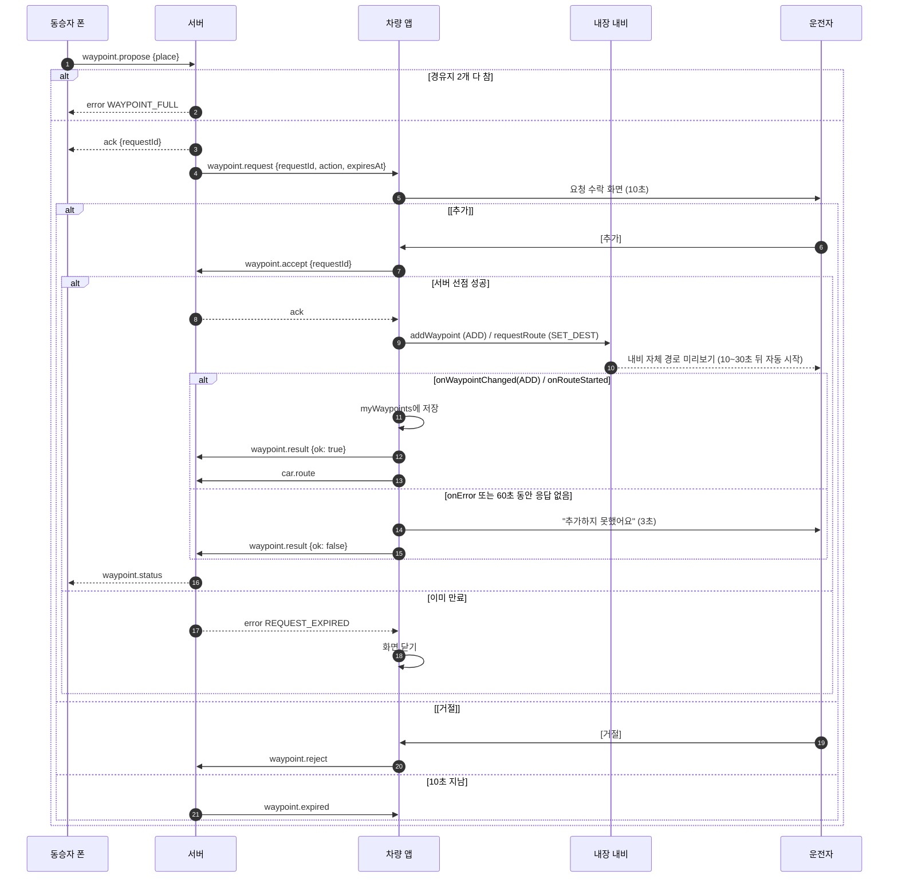

요청 1건의 상태 (`pendingRequest`):

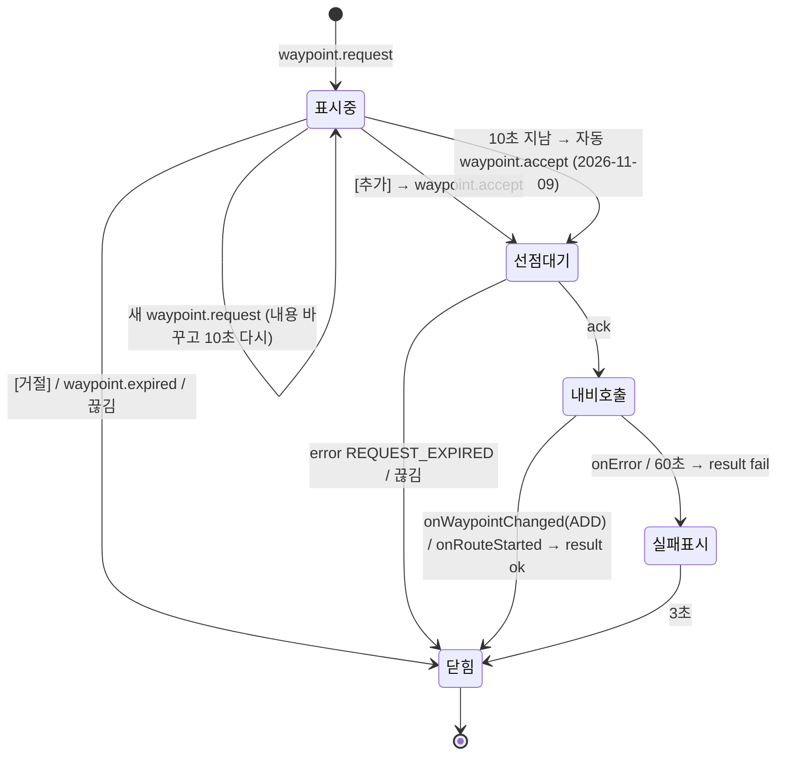

- 선점 대기 중에는 버튼을 잠급니다. 내비 호출 중에 끊기면 결과를 기억했다가 다시 붙은 뒤 `waypoint.result`를 보냅니다.

- 내비 호출: `ADD` → `addWaypoint` (경유지가 없으면 `FIRST`, 1개면 `SECOND`), `SET_DEST` → `requestRoute`. 경유지가 이미 2개면 부르지 않고 실패로 처리합니다 (내비가 아무 응답 없이 무시함).
- 호출하면 내비가 자체 경로 미리보기를 띄우고 10~30초 뒤 자동으로 안내를 시작합니다 (10장 에뮬레이터 결과).
- 성공: 경유지는 `onWaypointChanged(ADD)`, 목적지는 `onRouteStarted`가 오고 `onNavigationStatus`가 `ROUTE_DRIVE`가 되면 성공. `onDrivingInfo.waypoints`에 그 이름이 있는지도 봅니다. `myWaypoints`에 좌표·`requestId`를 저장하고 `waypoint.result {ok: true}`, 이어서 `car.route`. (`onRoutingCompleted`는 에뮬레이터에서 오지 않았음)
- 실패: `onError`가 오거나, **60초 안에 성공 콜백이 없으면** `waypoint.result {ok: false, error, message}` + 차 화면에 3초 동안 "추가하지 못했어요".

### 6-5. 에너지 제안

1. `energy`나 `drive.destination.remainDistM`이 바뀔 때마다 `rangeM < remainDistM + 20000`을 봅니다.
2. 처음 맞으면 `energy.low` 1번 → `alerted.energy = true`. 목적지가 바뀌거나 `rangeM`이 다시 늘면 지웁니다.
3. 목적지가 없으면 비교하지 않습니다.
4. 동승자가 없으면 서버가 `energy.suggest`를 차로 보냅니다 → 주행 중이면 음성, 정차하면 장소 목록의 주유·충전 탭.

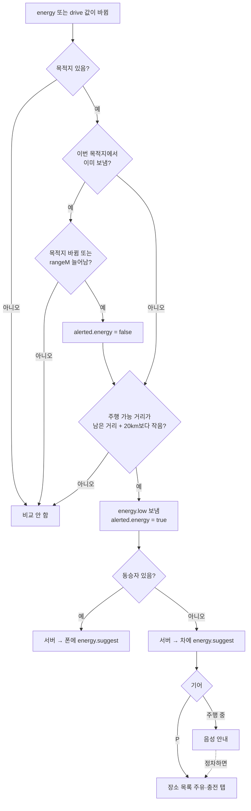

주차장(6-6)도 같은 모양입니다. 조건만 "남은 거리 10km 이하 또는 남은 시간 5분 이하"이고, 보내는 메시지가 `parking.near-dest`입니다.

### 6-6. 목적지 근처 주차장

1. 목적지 남은 거리 10km 이하 또는 남은 시간 5분 이하가 처음 되면 `parking.near-dest` 1번.
2. 동승자가 있으면 폰이 고르고 → 수락 화면(`SET_DEST`) → `requestRoute`로 목적지를 주차장으로 바꿈.
3. 동승자가 없으면 `parking.suggest`가 차로 옴 → 음성 → 정차하면 장소 목록의 주차장 탭에서 운전자가 고름.

### 6-7. 휴게소 접근·도착

`myWaypoints` 중 종류가 휴게소인 것만 봅니다.

| 조건 | 보낼 것 | 차 화면 |
|---|---|---|
| 그 경유지 남은 거리 2km 이하 (처음 한 번) | `restarea.approach` | 홈에 `곧 ○○휴게소` 한 줄. 동승자가 없으면 음성 |
| 도착 콜백, 또는 접근 뒤 기어 P | `restarea.arrived` | 휴게소 지도(4-7) + [출발해요]. 앱이 안 보이면 도착 알림 |
| 도착 뒤 기어 D | `restarea.left` | 카드 닫기, `myWaypoints`에서 지움 |

경유지 남은 거리는 `onDrivingInfo`에서 이름으로 찾습니다. 못 받으면 차 위치와 저장한 좌표의 직선거리로 대신합니다.

휴게소 경유지 1개의 상태:

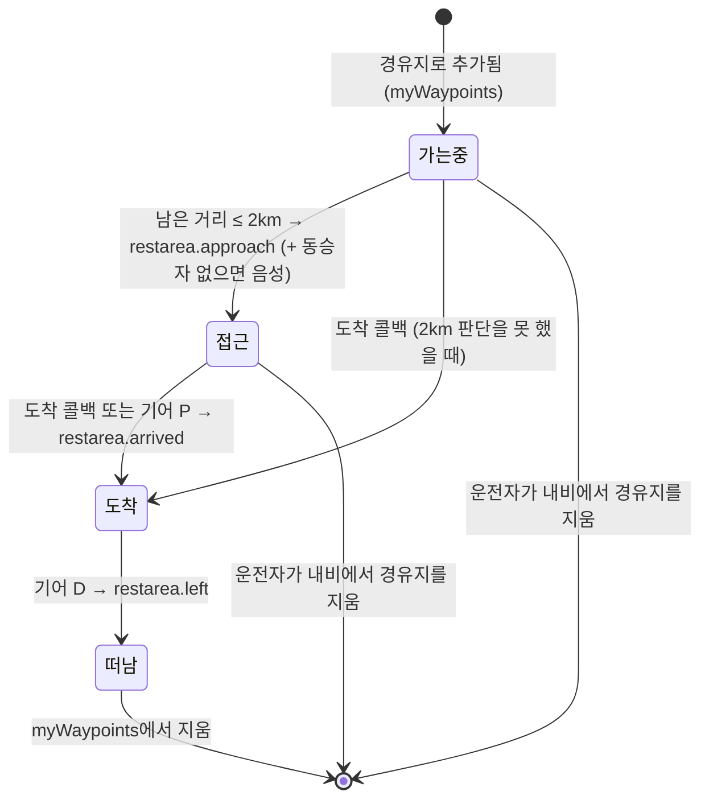

서버에 기록하지 않은 경유지(운전자가 직접 고른 것, `requestId` 없음)는 메시지를 보내지 않고 차 화면과 음성만 바뀝니다.

**도착했을 때 어디에 보이나 (2026-11-06 결정: 보조 창 + 알림)**
- 앱이 보이면(보조 창이든 전체 화면이든) 홈이 휴게소 지도(4-7)로 바뀌므로 그걸로 충분합니다.
- 앱이 안 보이면(내비만 보고 있으면) heads-up 알림을 한 번 띄웁니다. 제목 `○○휴게소 도착`, 본문 `영업 중 할리스커피 · 던킨도너츠 외 2곳` / `편의시설 수유실 · 샤워실 …`. 누르면 앱이 열리고 휴게소 지도가 보입니다. 알림은 휴게소 정보(3-7)를 받은 뒤 한 번 띄웁니다. 서버에 못 붙으면 연결 대기(5초) 뒤 "눌러서 휴게소 정보 보기"로 띄웁니다. 바로 띄우면 heads-up에 "불러오는 중"만 보이고 내용이 바뀌어도 다시 내려오지 않기 때문입니다 (2026-11-06 에뮬레이터).
- 도착은 기어 P에서만 생기므로 알림도 정차 중에만 뜹니다. 기어 D(떠남)나 앱을 열면 알림을 지우고, 한 번 본 도착은 다시 알리지 않습니다.
- 앱을 자동으로 앞으로 올리기(내비를 가림), 내비 자체 장소 팝업(`requestNavigationScreen(POIDetailPopup)`, 내비 장소 ID가 없고 우리 정보를 못 담음), 다른 앱 위에 그리기(권한 문제)는 쓰지 않습니다.
- 알림 채널: `wayon_rest_area`(중요도 HIGH, heads-up용). 포그라운드 서비스 알림 채널과 따로 둡니다.

### 6-8. 출발해요

1. 홈의 [출발해요] (P + 받을 동승자 1명 이상) → `departure.call`.
2. 대화 화면으로 바꿈. `departure.message`, `departure.status`를 받아 그림.
3. 운전자 답장: 빠른 답장 `TAKE_TIME`/`HURRY`, 텍스트 1~40자.
4. 끝: 기어 D(`DEPARTED`), [취소](`CANCELLED`), 서버의 30분 만료(`departure.closed EXPIRED`).
5. 남은 시간·도착 예정은 서버가 붙입니다. 차량 앱은 `car.route`만 제때 보내면 됩니다.

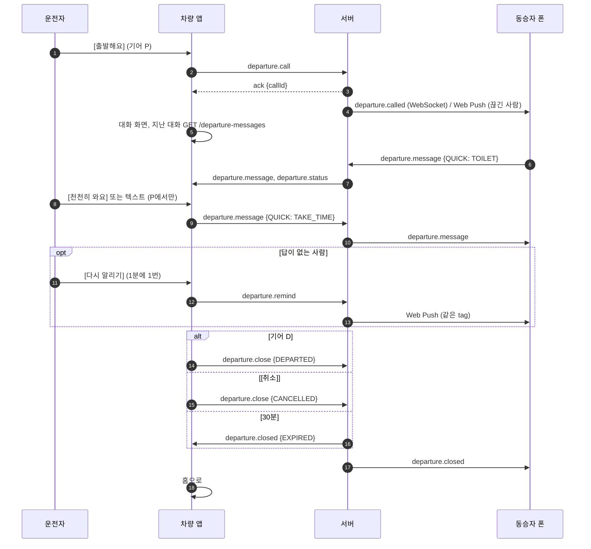

### 6-9. 음성 안내

- 동승자가 없을 때만, 에너지·주차장·휴게소 접근에서 한 번씩 말합니다.
- 말하기 전에 오디오 포커스를 요청하고, 앞에 150~200ms 묵음을 넣습니다.
- TTS를 못 쓰면 앱에 넣은 녹음 음원 3개(숫자 없는 고정 문구)를 재생합니다.

### 6-10. 동승자 해제

설정에서 [해제] → `DELETE` → 서버가 `passengers.update`를 보내면 목록이 바뀝니다.

---

## 7. 백그라운드, 끊김, 실패 처리

### 7-1. 백그라운드

- `WayOnService`는 포그라운드 서비스입니다. 타입은 **`specialUse`**입니다. `location` 타입은 Android 위치 권한(`ACCESS_*_LOCATION`)을 요구해서 에뮬레이터에서 앱이 죽었고, 우리는 위치를 NaviHelper로 받으므로 그 권한이 필요 없습니다. 상단 알림 문구는 "WAY:ON 연결 중".
- 휴게소에 도착했는데 앱이 안 보이면 도착 알림을 띄웁니다 (6-7).
- 내비가 앞에 있을 때 요청이 오면: 보조 창에 앱이 떠 있으면 수락 화면이 그대로 보입니다. 앱이 안 보이면 heads-up 알림(전체 화면 인텐트)으로 앱을 앞으로 불러옵니다. 둘 다 안 되면 13장 대안.
### 7-2. 서버 연결 상태

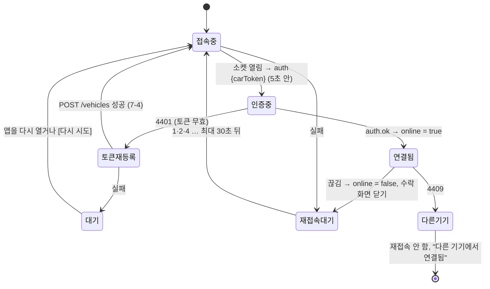

- 끊긴 동안 오프라인 띠를 보이고, 수락 화면은 닫습니다 (응답을 보낼 수 없으므로).
- ping 20초. 5분 동안 못 보내면 서버가 세션을 끝내고, 다시 붙으면 6-2의 2번으로 새 세션을 엽니다.
- 끊긴 동안 생긴 `car.*` 값은 버리고, 다시 붙으면 지금 값을 한 번씩 보냅니다. `waypoint.result`만 기억했다가 보냅니다.

### 7-3. 권한·동의를 거부했을 때

| 거부한 것 | 영향 | 차 화면 |
|---|---|---|
| 차량 쪽 위치 공유 동의 | 세션을 열 수 없음 (`trip.start`에 동의가 필요) | 홈에 "위치 공유에 동의해야 동승자와 연결돼요" + [동의하기]. 동승자 연결·출발해요 버튼 숨김 |
| 위치를 둘 다 못 읽음 | 경로 위 장소, 휴게소 접근 판단이 안 됨 | 홈에 "차 위치를 읽을 수 없어요" |
| 알림 권한 | 포그라운드 서비스는 돌지만 상단 알림이 안 보이고, 내비가 앞에 있을 때 heads-up으로 앱을 불러올 수 없음 | 설정 화면에 "알림을 켜면 내비 화면에서도 요청을 볼 수 있어요" + [설정 열기]. 홈에는 띄우지 않음 |

시스템 권한 창은 한 번 거부하면 다시 뜨지 않을 수 있어서, [설정 열기]는 앱 설정 화면(`ACTION_APPLICATION_DETAILS_SETTINGS`)으로 보냅니다.

### 7-4. 차량 토큰이 안 먹을 때

앱 데이터를 지웠거나, 서버 DB를 초기화했거나, 토큰 파일이 깨진 경우입니다.

1. REST `401 TOKEN_INVALID` 또는 WebSocket `4401`을 받으면 저장한 토큰을 지우고 `POST /api/vehicles`로 다시 등록합니다.
2. 새 차량이 되므로 등록돼 있던 동승자는 모두 끊깁니다. 홈에 "동승자 연결이 초기화됐어요. QR로 다시 연결해 주세요"를 한 번 띄웁니다.
3. `myWaypoints`, `alerted`도 지웁니다.
4. **앱을 켤 때마다 다시 등록은 1번만** 합니다. 그래도 실패하면 오프라인 띠에 "서버에 연결할 수 없어요" + [다시 시도]를 보이고 멈춥니다 (무한 반복 방지).

### 7-5. 오류 코드별 차 화면 처리

app-api.md 8장 중 차량 앱이 받을 수 있는 것만 적었습니다. 문구는 서버 `message`를 그대로 쓰고, 아래 "차 화면"은 그 밖의 동작입니다.

| 코드 | 언제 | 차 화면 |
|---|---|---|
| `TOKEN_INVALID` | 모든 요청 | 7-4 |
| `PASSENGER_LIMIT` | QR 코드 발급 | QR 대신 "동승자는 4명까지예요. 설정에서 해제할 수 있어요" + [설정으로] |
| `TRIP_NOT_ACTIVE` | 장소 목록, 출발해요 | `trip.start`를 다시 보내고 한 번 더 시도. 또 실패하면 "연결 준비 중" |
| `NO_ROUTE` | 장소 목록 | 목록 대신 "내비에서 목적지를 설정해 주세요" |
| `EXTERNAL_UNAVAILABLE` | 장소 목록 | 목록 대신 "잠시 뒤에 다시 시도해 주세요" + [다시 시도] |
| `REQUEST_EXPIRED` | 수락 | 수락 화면 닫기 (문구 없음) |
| `CALL_ALREADY_OPEN` | [출발해요] | 열린 출발 알림의 대화 화면으로 감 (WebSocket을 다시 인증해 `openCall`을 받음) |
| `CALL_CLOSED` | 대화 화면에서 보내기 | 대화 화면을 닫고 홈, "출발 알림이 끝났어요" 3초 |
| `REMIND_TOO_SOON` | [다시 알리기] | 버튼을 남은 시간 동안 잠금 (보통 버튼을 미리 잠가서 오지 않음) |
| `MESSAGE_INVALID` | 운전자 메시지 | 입력한 글을 지우지 않고 "보낼 수 없는 메시지예요" |
| `FORBIDDEN_ROLE`, `BAD_REQUEST` | 어디서든 | 화면에는 안 보이고 로그만 (앱 버그) |
| 응답 없음 (REST 10초) | 어디서든 | "잠시 뒤에 다시 시도해 주세요" + [다시 시도] |

---

## 8. 입력

- 모든 버튼은 터치와 CCP 다이얼(돌리기 = 포커스 이동, 누르기 = 선택) 둘 다 됩니다. Compose의 `focusable`·키 이벤트로 처리합니다.
- 수락 화면은 처음 포커스를 [추가]에 둡니다.
- 스티어링 휠 버튼은 에뮬레이터가 지원하지 않아 넣지 않습니다.

---

## 9. 시연용 위치 재생

에뮬레이터는 차 위치가 움직이지 않아서 휴게소 접근, 주차장 알림, 경로 이탈을 시연할 수 없습니다. 그래서 미리 만든 경로를 따라 차가 움직이는 것처럼 꾸밉니다.

- 경로 파일: `assets/demo/*.json`. `[{"lat", "lng", "speedKmh"}]` 점 목록. 시연 구간 1~2개를 넣습니다 (예: 서울 → 경부선 휴게소 → 목적지).
- 켜면 `DemoReplay`가 1초마다 다음 위치를 계산해 `NaviBridge` 대신 위치를 줍니다.
- 남은 거리·시간도 경로 파일을 따라 계산해 대신 줍니다 (목적지와 `myWaypoints`까지의 경로상 거리). 그래서 6-5~6-7의 판단이 실제와 같은 코드로 돕니다.
- 속도 배율(1배, 5배, 20배)을 고를 수 있게 합니다. 기어·주행 가능 거리는 Virtual Console로 바꿉니다.
- 화면 위에 작게 "시연 모드"를 표시합니다. 릴리스 APK에서는 설정에서 켜야만 동작합니다.

---

## 10. 사용하는 SDK와 권한

| 쓰는 곳 | SDK · API | 권한 |
|---|---|---|
| 기어 | Vehicle `Gear.registerGearSelection()` | `pleos.car.permission.CAR_DRIVE` |
| 주행 가능 거리 | Vehicle `Odometer.registerRangeRemainingListener()` (안 나오면 `CarPropertyManager` `RANGE_REMAINING`) | `CAR_DRIVE` |
| 연료·배터리 % | Vehicle `Fuel.registerFuelPercent()`, `EvBattery.registerEvBatteryStateOfCharge()` | `pleos.car.permission.CAR_ENERGY` |
| 위치 | NaviHelper `getCurrentLocationInfo()` (FusedLocation은 에뮬레이터에서 미국 좌표라 빼고 권한도 없앰, 2026-11-09) | `NAVI_ROUTE` |
| 목적지·경유지 남은 거리 | NaviHelper `onDrivingInfo` | `NAVI_ROUTE` |
| 경유지·목적지 바꾸기 | NaviHelper `addWaypoint(RequestWaypointInfo)`, `requestRoute(RouteInfo)`, `onRoutingCompleted`, `onError(NaviErrorCode)` | **`NAVI_ROUTE_SEARCH`** (normal) |
| 경유지 좌표·도착 | NaviHelper `getWaypointInfo()` → `onWayPointInfo` (좌표 있음), `onWaypointChanged`, `onWayPointArrived` | `NAVI_ROUTE` |
| 음성 | TextToSpeech `Mode.ON_DEVICE`, `setAudioAttributes(내비 안내)` | `pleos.car.permission.TTS_SERVICE` |
| 주행 규제 | `CarUxRestrictionsManager` (`android.car`, `useLibrary`) | — |
| QR | ZXing core (추가) | — |
| 통신 | Retrofit 2.11 + Gson, OkHttp 4.12 WebSocket | `INTERNET` |
| 서비스 | 포그라운드 서비스 (`specialUse`) | `FOREGROUND_SERVICE`, `FOREGROUND_SERVICE_SPECIAL_USE`, `POST_NOTIFICATIONS` |

연료차·전기차 구분 API는 없어서, 연료 %와 배터리 % 중 값이 나오는 쪽으로 정합니다.

**SDK 소스로 확인한 것 (2026-11-05, NaviHelper 3.0.5 · navi-data 3.0.4 · TextToSpeech 3.3.1 · Vehicle 2.3.2)**
- 경유지는 **2개까지**: `WaypointIndex`가 `FIRST`, `SECOND`(+ 지울 때 쓰는 `ALL`)뿐입니다.
- `addWaypoint`는 `RequestWaypointInfo.waypointIndex`로 넣을 자리를 지정합니다. 경유지가 없으면 `FIRST`, 1개 있으면 `SECOND`로 넣습니다.
- `addWaypoint`·`requestRoute`·`removeWaypoint`는 `NAVI_ROUTE`가 아니라 **`NAVI_ROUTE_SEARCH`** 권한이 필요합니다 (매니페스트에 추가함).
- `getWaypointInfo()` → `onWayPointInfo`에 좌표 필드가 있지만, **에뮬레이터에서는 `0.0, 0.0`이 옵니다** (아래 에뮬레이터 결과). 그래서 좌표는 지금 설계대로 앱이 `addWaypoint`할 때 쓴 값을 기억합니다.
- 경유지 도착 콜백 이름은 `onWayPointArrived`입니다 (app-api 5-9의 오타 고침).
- 운전자가 내비에서 경유지를 지우면 `onWaypointChanged(cmdType = REMOVE)`가 옵니다. 6-7의 "경유지를 지움"은 이걸로 판단합니다.
- TTS 권한 `pleos.car.permission.TTS_SERVICE` 맞음.
- Vehicle의 기어·주행 가능 거리·연료·배터리 함수는 `VehicleCheck.kt`가 빌드되므로 이름이 맞습니다.

**에뮬레이터로 확인한 것 (2026-11-05, 임시 확인 코드 `SdkCheck.kt`로 시험 후 삭제, API 34)**

| 항목 | 결과 | 설계에 주는 영향 |
|---|---|---|
| 차량 값 | 주행 가능 거리 500km, 배터리 100%, 기어 `GEAR_PARK` 나옴. **연료 %는 오류** (전기차라 속성 없음) | 설계대로 "값이 나오는 쪽"으로 연료차·전기차 판단. 연료 쪽 오류는 무시 |
| 위치 | NaviHelper는 한국 좌표(성남), **FusedLocation은 미국 좌표**(에뮬레이터 기본값) | 위치는 NaviHelper만 씀 |
| 경유지 추가·목적지 변경 | 동작함. 호출하면 내비가 지금 안내를 취소(`onRouteCancelled`, `FREE_DRIVE`)하고 **자체 경로 미리보기 화면**(경로 3개 + [안내 시작] 카운트다운)을 앞에 띄움. 10~30초 뒤 **자동으로 안내 시작** | 운전자가 아무것도 안 눌러도 반영되므로 우리 수락 화면은 그대로 둠 (운전자 동의는 우리 화면에서 받음) |
| 성공 콜백 | **`onRoutingCompleted`는 한 번도 오지 않음.** 목적지는 `onRouteStarted`, 경유지는 `onWaypointChanged(ADD)` + `onNavigationStatus(ROUTE_DRIVE)`가 옴 | 6-4의 성공 판단을 이 콜백으로 바꿈 |
| `onWaypointChanged.index` | 2번째 경유지를 넣어도 `FIRST`로 옴 | index는 믿지 않고 `onDrivingInfo.waypoints`로 개수·이름 확인 |
| 경유지 3개째 | **아무 콜백 없이 무시됨** (`onError`도 없음) | 서버가 2개에서 막는 결정이 맞음. 앱도 2개면 호출하지 않음 |
| 경유지 좌표 | `onWayPointInfo`의 좌표가 `0.0, 0.0` | 좌표는 앱이 기억 |
| 경유지 모두 지우기 | 경로가 취소된 뒤 경유지 없이 원래 목적지로 다시 안내 | — |
| TTS | `initialize()`를 `addEventListener()`보다 **먼저** 불러야 함 (반대면 앱이 죽음). 초기화 → `onReady` → `onStart`까지 됨 (화자 `seoyoon`, `ko_KR`) | 소리가 실제로 나는지는 사람이 들어서 확인 필요 |
| 포그라운드 서비스 | `location` 타입은 Android 위치 권한(`ACCESS_*_LOCATION`)이 없어서 **앱이 죽음**. `specialUse` 타입으로 바꾸니 앱을 내린 뒤 60초가 지나도 살아 있음 | 7-1, 매니페스트 수정함 |
| 에뮬레이터 안정성 | 경로 계산 중 에뮬레이터 시스템이 한 번 재시작됨 (부하 20 안팎) | 시연 전 에뮬레이터를 새로 켜고 다른 앱을 닫아 둠 |

**Pleos 공식 문서와 대조한 것 (2026-11-05, document.pleos.ai)**

| 항목 | 공식 문서 | 이 설계 |
|---|---|---|
| NaviHelper 권한 | `NAVI_ROUTE`: `get*Info()`, `requestTrip()` / `NAVI_ROUTE_SEARCH`: `requestRoute`, `addWaypoint`, `removeWaypoint`, `cancelRoute` 등 | 맞음 (둘 다 선언) |
| 경유지 | "최대 2개, `FIRST`·`SECOND`로 구분". 예시는 `requestRoute`로 목적지를 먼저 정하고 `addWaypoint` | 맞음. 목적지가 없을 때는 `SET_DEST`로 목적지부터 정함 |
| 결과 콜백 | 경로 요청 결과는 `onRouteStarted`, `onRoutingCompleted`, `onError`로 확인. 단 **"전달되는 이벤트는 내비 앱 구현에 따라 다를 수 있음"** | 에뮬레이터에서 `onRoutingCompleted`가 안 온 것과 맞음. 성공을 여러 콜백 중 하나로 판단하고 60초 시한을 둔 설계가 맞음 |
| 초기화 순서 | NaviHelper: `initialize(onConnected, onFailed)` 뒤에 리스너 등록. TTS: 생성 → `initialize()` → `addEventListener()` → `setLocale()` → `speak()` | 맞음 (TTS 순서는 에뮬레이터에서 앱이 죽어 알게 된 것과 같음) |
| TTS 모드 | `ON_DEVICE`는 네트워크·앱 등록이 필요 없음. 기본값 `HYBRID`는 앱 등록 필요 | `ON_DEVICE` 사용, 맞음 |
| 운전 중 제한 | QR sign-in은 모든 지역에서 주행 중 금지. 키보드는 "기타 지역(한국)" 주행 중 허용, 정차 중 모든 지역 허용. 주행 상태는 `CarUxRestrictionsManager`로 받음 | 주행 중 QR 숨김 맞음. 텍스트 입력은 더 엄격하게 P에서만. **정차 = 기어 P이고 `isRequiresDistractionOptimization()`이 false** (`UxRestrictions.isParked`, 11/9). 규제 값을 못 받으면 기어만 봄 (플랫폼보다 엄격). 휴게소 지도·도착 heads-up 알림도 이 기준 |
| DO 선언 | Pleos 문서에는 매니페스트 이름이 없음. Android Automotive 문서의 `<meta-data android:name="distractionOptimized" android:value="true"/>` | 그대로 사용 |
| 오디오 포커스 (11/9) | 안내 음성은 `USAGE_ASSISTANCE_NAVIGATION_GUIDANCE` + `GAIN_TRANSIENT_MAY_DUCK`. 포커스 변경 이벤트 처리 필수, 거절(통화·긴급)은 정상 처리 | TTS SDK 기본 소리 종류가 `USAGE_MEDIA`라 `setAudioAttributes`로 내비 안내를 넘김. 거절되면 건너뜀, 잃으면 멈춤, 끝 콜백이 15초 안 오면 포커스 놓음 |
| 음성 앞 묵음 (11/9) | 150~200ms, 음성 데이터 앞 무음이 1순위, 재생 지연은 권장 안 함 | 200ms. SDK가 문장만 받아(`speak(text)`) 재생 지연만 가능 |
| 브라우저 기능 (11/9) | 심사 가이드: 운전 중 동영상·게임·브라우저 금지 | 휴게소 지도 웹뷰는 페이지 이동을 모두 막음 (`shouldOverrideUrlLoading` → true) |
| 보안 가이드 | 토큰을 URL에 넣지 않음, HTTPS, Keystore로 키 보관, 민감 정보 로그 금지, 필요 없는 컴포넌트·권한 노출 금지, 릴리스 서명·디버그 끄기 | 대부분 반영됨. 릴리스 전 할 일은 14장 |

아직 못 본 것: 내비 미리보기에서 운전자가 [X]로 취소했을 때 기존 안내가 어떻게 되는지 (내비 화면이 앞에 안 뜰 때가 있어 누르지 못함), 기어 D에서의 동작 (Virtual Console 조작 필요), TTS 소리.

---

## 11. 기준값

app-api.md 9장 값을 따르고, 차량 앱에만 있는 값을 더했습니다. 코드에서는 한 파일(`Config.kt`)에 모읍니다.

| 항목 | 값 |
|---|---|
| 위치 전송 | 5초마다 |
| 목적지 남은 거리·시간만 바뀔 때 | 30초에 1번 |
| 에너지 전송 | 바뀔 때만, 최대 1분에 1번 |
| 에너지 여유 | 20km |
| 휴게소 접근 | 경유지 남은 거리 2km |
| 주차장 | 목적지 10km 또는 5분 |
| 수락 대기 | 10초 |
| 출발해요 다시 알리기 | 1분 |
| 메시지 | 40자 |
| QR | 3분마다 새로 (그동안 여러 명), 동승자 최대 4명 |
| ping | 20초 |
| 재접속 | 1·2·4 … 최대 30초 |
| 실패 문구 표시 | 3초 |
| 음성 앞 묵음 | 200ms |

---

## 12. app-api.md에 더하거나 맞출 것

app-api.md를 따르되, 앱 결정 때문에 규격에 더할 것이 있습니다. 나중에 합칠 때 반영합니다.

| # | 항목 | 내용 |
|---|---|---|
| 1 | 장소 목록을 차량 토큰으로 | `GET /trips/current/places`, `GET /rest-areas/{id}`를 차량 토큰으로도 부를 수 있게 (app-api 9장에 이미 적혀 있음). 차 화면 장소 목록과 휴게소 도착 카드에 씀. `PARKING` 타입도 필요 |
| 2 | 경유지가 다 찼을 때 | `REPLACE_FIRST`를 없앰. 경유지 2개가 찼으면 서버가 `waypoint.propose`에 `error WAYPOINT_FULL` ("경유지가 가득 찼어요")을 돌려주고 차로 보내지 않음. `action`은 `ADD`, `SET_DEST`만 남고 `waypoint.request`의 `replaceTarget`도 없앰. erd.md `waypoint_request.action`도 같이 고침 |
| 3 | 운전자가 직접 고른 장소 | 서버에 기록하지 않음. 규격 추가 없음, `car.route`만 보냄 (동승자 폰 지도에는 반영됨) |
| 4 | 실패를 차에도 표시 | way-on.md 3.5는 "오류는 폰에만"인데 앱 결정 24번은 차에도 3초 보여 줌. 차 화면만 바뀌므로 규격은 그대로 |
| 5 | 동승자 없을 때 주차장 제안 | `parking.suggest`가 차로 오는 것은 app-api에 있음. 차에서 고르면 3번과 같은 흐름 |

---

## 13. 에뮬레이터에서 확인할 것

2026-11-05에 확인한 것은 ✅, 남은 것은 ⬜입니다. 결과는 10장 표.

| | 항목 | 결과 / 안 되면 |
|---|---|---|
| ✅ | Pleos 자체 확인 창 | 확인 창이 아니라 **경로 미리보기 + 자동 시작 카운트다운**. 운전자 동의 없이 반영되므로 우리 수락 화면 유지 |
| ✅ | 경유지 2개 한도, 3개째 | SDK 소스로 2개 확인. 3개째는 응답 없이 무시됨 |
| ✅ | 포그라운드 서비스 유지 | `specialUse` 타입으로 앱을 내린 뒤 60초 유지. WebSocket을 붙인 상태로는 개발하면서 다시 봄 |
| ✅ | 기어·주행 가능 거리·배터리 % | 나옴. 연료 %는 전기차라 오류 (정상) |
| ✅ | `onDrivingInfo`의 경유지 남은 거리 | 경유지 이름과 남은 거리가 옴 |
| 🔸 | TTS | 초기화·말하기 시작까지 됨. **소리는 사람이 들어서 확인**, 내비 음성과 겹칠 때도 남음 / 안 되면 녹음 음원 |
| ⬜ | 내비 미리보기에서 [X]로 취소했을 때 기존 안내 | 기존 안내가 사라지면 실패로 처리하고 운전자에게 알림 |
| ⬜ | 기어 D에서 화면 닫기·출발해요 종료 | Virtual Console로 기어 바꿔서 확인 |
| 🔶 | 내비가 앞에 있을 때 heads-up 알림 (경유지 요청, 휴게소 도착 6-7) | 보조 창에 앱을 띄워 두는 것을 시연 조건으로. 휴게소 도착 알림은 2026-11-06 에뮬레이터에서 내비 위에 뜨는 것 확인 |
| ⬜ | 시동을 껐다 켰을 때 앱이 다시 뜨는지 | 운전자가 앱을 다시 열면 6-2로 복구 |
| ⬜ | CCP 다이얼 키 이벤트 | 터치만 |
| ⬜ | 주행 중 4자리 코드 허용 (Pleos 문의) | 지금처럼 자동 재연결만 |

---

## 14. 할 일 (세팅)

2026-11-05 세팅에서 한 것: ZXing, `lifecycle-service`, 음성·포그라운드 서비스·알림 권한, DO 선언, `service/WayOnService.kt` 뼈대, `Config.kt`(11장 기준값), 서버·웹 주소 빌드 설정값, 디버그 빌드만 `http` 허용. `assembleDebug` 통과.

- [x] **서비스 실행 연결** (11/5): `MainActivity`가 켜질 때 `WayOnService`를 띄우고 알림 권한을 요청함. 서비스는 `CarSignals`(기어·주행 가능 거리·연료·배터리)를 시작. bind는 화면을 붙일 때 (`LocalBinder` 준비됨)
- [x] **임시 확인 화면 정리** (11/5): `LocationCheck.kt`, `VehicleCheck.kt`, `SdkCheck.kt`와 `MainActivity`의 확인용 화면·adb 명령 처리를 지움. `NaviBridge`, `CarSignals`는 10장 결과대로 새로 작성
- [ ] **서버·웹 주소**: 지금은 로컬 개발용(`http://10.0.2.2:8080`, `http://localhost:5173`). 서버 배포처와 Vercel 주소가 정해지면 `app/build.gradle.kts`의 `SERVER_URL`, `WEB_URL`을 바꿈. 디버그·릴리스 값을 나눌지도 그때 정함
- [ ] **DO 선언 이름 확인**: Android Automotive 표준 `distractionOptimized`를 씀. Pleos도 같은지 문서로 확인하고, 에뮬레이터에서 주행 중 수락 화면이 막히지 않는지 봄
- [ ] **릴리스 서명**: 서명 키 만들기, `signingConfigs` 설정. 키 파일과 비밀번호는 저장소에 넣지 않음
- [ ] **APK 이름**: 릴리스 출력 이름을 `WayOn_WayOn_release.apk`로 (신청서 팀명 확인 후). 제출 위치는 `apk/`
- [x] **FusedLocation 빼기** (11/9): 에뮬레이터에서 미국 좌표만 주고 위치는 NaviHelper로 받으므로, SDK 의존성과 `FUSED_LOCATION` 권한을 뺌 (보안 가이드 "필요 없는 권한 금지")
- [ ] **릴리스 로그 끄기**: 위치·토큰이 들어가는 로그는 릴리스에서 안 나오게 (보안 가이드 "민감 정보 로그 금지")
- [ ] **릴리스 난독화**: 지금 `isMinifyEnabled = false`. 켤 경우 Gson 모델·Pleos SDK가 깨지지 않게 `proguard-rules.pro`에 규칙 추가. 시간이 없으면 끈 채로 제출
