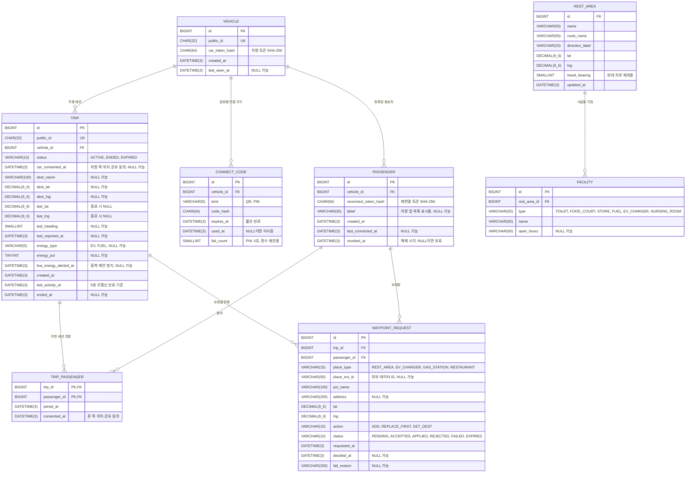

# 설계 변경 사항 (design.md v0.1 → Co-Pilot Connect 기획서)

> 기준: 「Co-Pilot Connect 기획·설계서」(2026-10-23, Claude Docs). design.md보다 나중에 나온 기획서이므로, 서로 다른 부분은 **이 문서와 기획서가 우선**합니다.
> design.md 본문은 고치지 않았습니다. 여기 적힌 부분 말고는 design.md를 그대로 따릅니다.
> 상태: **검토 대기**. ERD·schema.sql은 이 문서가 승인되면 반영합니다.

---

## 0. 한 줄 요약

서비스 이름은 **Co-Pilot Connect**입니다. 휴게소 안 안내(접근·진입·주차, 배치도, 주차 위치)와 날씨 브리핑은 MVP에서 뺍니다. 대신 **경로 주변 장소 검색**(휴게소·충전소·맛집), **에너지 부족 자동 제안**, **자동 재연결**, **주행 중 QR 연결**을 넣습니다. 차-폰 통신은 폴링에서 **WebSocket**으로 바꿉니다.

---

## 1. 무엇이 바뀌나 (요약)

| 항목 | design.md v0.1 | 변경 후 | 근거 (기획서) |
|---|---|---|---|
| 서비스 이름 | RestMate (휴게소·도착 동반 앱) | Co-Pilot Connect | 1장 |
| 장소 종류 | 휴게소만 (Q2) | 휴게소, 전기차 충전소, 맛집 (+ 에너지 제안 때 주유소) | 3장 |
| 차-폰 통신 (D1) | 서버 중계 + 5초 폴링 | 서버 중계 + **WebSocket (WSS)** | 9장, 13장 |
| 차량 위치 | FusedLocation SDK | NaviHelper `getCurrentLocationInfo()` (FusedLocation은 준비 중) | 7장 |
| 음성 (TTS) | MVP에 포함 | 확장 단계 (SDK 공개 후) | 3장, 10장 |
| 휴게소 상태 안내 (F4) | MVP | **삭제** | 기획서에 없음 |
| 주차 위치·배치도 (F5) | MVP | **삭제** | 기획서에 없음 |
| 도착 날씨 브리핑 (F6) | MVP | **삭제** | 기획서에 없음 |
| 연결 단위 | 여행 1건마다 토큰 2개 | 차량·동승자를 등록해 두고 **자동 재연결** | 3장, 시나리오 C |
| QR 토큰 | 여행 동안 유효한 폰 토큰 | **일회용 짧은 만료 토큰**, 쓰면 폐기 | 9장 |
| 주행 중 연결 | 다루지 않음 | 버튼 없는 QR 전용 화면 최대 20초, 대체로 4자리 코드 | 3장, 8장 |
| 운전자 무반응 | 60초 뒤 만료 | **10초 뒤 자동 거절** | 6장 |
| 경유지 개수 | 다루지 않음 | 최대 2개. 다 찼으면 1번과 교체할지 물음 | 6장, 7장 |
| 목적지 없음 | 다루지 않음 | 고른 장소를 `requestRoute()`로 목적지로 설정할지 물음 | 6장 |
| 오류 표시 | 차 화면에 짧게 알림 | **동승자 폰에만** 표시. 운전자 화면에는 띄우지 않음 | 3장, 8장 |
| 세션 만료 | 최대 24시간 | **통신 없이 5분**이면 만료, 토큰 폐기 | 6장, 9장 |
| 위치 공유 동의 | 다루지 않음 | 차량과 폰 양쪽에서 동의 후 공유 | 9장 |
| 에너지 잔량 | 다루지 않음 | Vehicle SDK 배터리·연료 20% 미만 → 동승자 폰에 충전소·주유소 제안 | 3장, 시나리오 E |
| 외부 데이터 | 한국도로공사, 기상청 | 한국도로공사, 환경부 충전소, 오피넷(주유소), 맛집 출처 미정 | 7장, 13장 |

---

## 2. MVP 기능 목록 (design.md 2.1 대체)

| # | 기능 | 세부 | 비고 |
|---|---|---|---|
| F1 | QR 연결 | 차량 앱이 일회용 토큰 QR 표시(정차: 일반 화면, 주행: QR 전용 화면) → 폰이 스캔해 웹 접속 → 위치 공유 동의 → 연결되면 `requestNavigationScreen()`으로 내비 복귀 | 시나리오 A |
| F2 | 경로 주변 검색 | 차량 현재 위치·목적지 기준, 경로 반경 안의 휴게소·충전소·맛집 | 시나리오 B |
| F3 | 원터치 경유지 반영 | 폰 "차로 전송" → 차량 알림 [추가]/[거절] → 수락 시 `addWaypoint()` | 시나리오 B |
| F4 | 반영 결과 피드백 | `onRoutingCompleted` / `onError`를 폰에만 표시 | |
| F5 | 자동 재연결 | 한 번 연결한 동승자는 다음 탑승부터 QR 없이 연결. 차량 앱에서 등록 동승자 확인·해제 | 시나리오 C |
| F6 | 에너지 기반 자동 제안 | 배터리(EvBattery)·연료(Fuel) 20% 미만 → 동승자 폰에 경로 주변 충전소·주유소. 동승자가 없으면 보내지 않음 | 시나리오 E |
| F7 | 주행 중 QR 연결 | 동승자가 앱을 열 때만 QR 전용 화면. 연결 즉시 또는 20초 뒤 내비 복귀. 불가하면 알림 속 4자리 코드 | 시나리오 D |
| — | 음성 수락·안내, 쿠폰·주문, 뒷좌석 다중 연결 | 확장 | |

일정이 부족할 때 줄이는 순서(design.md 4.4 대체, 제안): **F7 → F6 → F5**. F1~F4가 핵심 흐름입니다.

---

## 3. 주요 결정 변경 (design.md 3.1)

| 결정 | 이전 | 변경 | 비고 |
|---|---|---|---|
| D1 차-폰 연결 | 폴링 | **WebSocket**. 차량 앱과 폰이 각각 서버에 WSS로 붙고, 서버가 메시지를 전달합니다. 조회성 API(검색 등)는 HTTPS REST 유지 | design.md 1.1 "쓰지 않는 것"에서 WebSocket 제외. Spring WebSocket(서버), OkHttp WebSocket(차량 앱), 브라우저 기본 WebSocket(폰) |
| D2 heartbeat | 위치 보고 + 요청 수신을 한 번에 | 위치 보고는 WebSocket 메시지로. 5분 동안 메시지가 없으면 세션 만료 | |
| D4 인증 | 여행 단위 토큰 2개 | 차량 토큰(설치당 1개) + 동승자 재연결 토큰(동승자당 1개) + 일회용 연결 코드(QR/4자리) | 4장 ERD |
| D5 후보 계산 | 진행 방향·목적지 근사 | 유지하되 장소 종류가 늘어남. `getCurrentLocationInfo()` 값이 부족하면 서버에서 길찾기 API로 경로 계산 (기획서 12장) | 진행 방향(heading)을 받을 수 있는지 미확인 |
| D6 상태 머신 | `ArrivalStateMachine` (차량 앱) | **삭제** (F4 삭제) | |
| D7 경유지 추가 순서 | 서버 선점 → 내비 → 결과 기록 | **유지**. 교체(`removeWaypoint(FIRST)` → `addWaypoint()`)와 목적지 설정(`requestRoute()`)도 같은 순서 | |
| D8 날씨 규칙 | if 문 4~5개 | **삭제** (F6 브리핑 삭제) | |
| D9 휴게소 데이터 | SQL seed + 배치도 이미지 | 휴게소는 seed 유지(배치도 없음). 충전소·주유소·맛집은 외부 API를 서버에서 호출하고 DB에 저장하지 않음 | 값이 자주 바뀜(빈 충전기, 유가) |

**design.md에서 그대로 유지하는 것:** 언어·프레임워크·버전(1.1), 기능별 패키지와 계층 책임(1.2, 1.3), 공통 기능(1.6, 단 `TripTokenInterceptor`는 토큰 종류에 맞게 수정), 코딩 규칙(1.8), 토큰 해시 저장, 조건부 UPDATE와 `FOR UPDATE` 잠금(2.6), 선점 후 실행.

---

## 4. ERD 변경 — 바뀌어야 합니다

바뀌는 이유는 세 가지입니다.

1. **자동 재연결(F5)**: 지금은 토큰이 여행(`trip`)에 묶여 있어서 여행이 끝나면 사라집니다. 다음 탑승에도 쓰려면 차량과 동승자를 따로 저장해야 합니다.
2. **장소 종류 확대(F2)**: 충전소·맛집은 우리 DB에 없습니다. 그래서 `waypoint_request.rest_area_id` FK 대신 요청 당시의 장소 정보(이름, 좌표, 주소)를 그대로 저장합니다. NaviHelper `addWaypoint()`에 넘기는 값과 같습니다.
3. **기능 삭제**: 주차(`parking_record`)와 배치도(`rest_area.layout_*`, `facility.layout_*`)가 필요 없어집니다.

### 4.1 테이블별 변경

| 테이블 | 변경 | 내용 |
|---|---|---|
| `vehicle` | **신규** | 차량 앱 설치 1개. 차량 토큰 해시 보관 |
| `passenger` | **신규** | 차량에 등록된 동승자 1명. 재연결 토큰 해시, 해제 시각 |
| `connect_code` | **신규** | 일회용 연결 코드 (QR 토큰 또는 4자리 코드). 짧은 만료, 사용 시각 |
| `trip` | **수정** | 토큰 컬럼 2개 삭제 → `vehicle_id`. `expires_at`(24시간) → `last_activity_at`(5분 무통신 만료). `last_heading` NULL 허용 유지. 에너지 잔량·차량 쪽 동의 시각 추가 |
| `trip_passenger` | **신규** | 이번 세션에 연결된 동승자와 위치 공유 동의 시각 |
| `waypoint_request` | **수정** | `rest_area_id` FK 삭제 → 장소 정보(종류, 이름, 주소, 좌표, 외부 ID). 요청한 동승자, 동작 종류(추가/교체/목적지 설정) 추가 |
| `rest_area` | **수정** | `entry_radius_m`, `layout_image_path`, `layout_w`, `layout_h` 삭제. `travel_bearing`은 반대 차로 제외에 계속 씀 |
| `facility` | **수정** | `layout_x`, `layout_y` 삭제. "충전 가능한 휴게소" 같은 필터에 종류만 씀 |
| `parking_record` | **삭제** | F5(주차 위치) 삭제 |

### 4.2 변경 후 ERD



### 4.3 상태 값

**trip.status**: `ACTIVE` → `ENDED`(차량 앱이 종료) 또는 `EXPIRED`(5분 무통신)

**waypoint_request.status**: 전이 규칙은 design.md 3.4와 같습니다.
```
PENDING  → ACCEPTED | REJECTED | EXPIRED
ACCEPTED → APPLIED  | FAILED
```
10초 무반응 자동 거절은 `EXPIRED`로 기록합니다. 운전자가 직접 누른 [거절](`REJECTED`)과 구분하려는 것입니다. 폰에는 둘 다 "운전자가 추가하지 않았어요"로 보여 줍니다.

### 4.4 보관 기간

| 데이터 | 보관 |
|---|---|
| `trip`의 위치·목적지·에너지 값 | 세션 종료·만료 즉시 NULL |
| `connect_code` | 사용하거나 만료되면 삭제 |
| `passenger` | 차량 앱에서 해제할 때까지 (최대 기간은 미정, 6장 Q3) |
| `waypoint_request`의 장소 좌표 | 공개 장소 좌표라 개인 위치가 아님. 세션 종료 후 보관 기간은 미정 (6장 Q4) |

---

## 5. design.md 섹션별 영향

| 섹션 | 영향 |
|---|---|
| 0 요약, 2.1 기능, 2.2 흐름 | 이 문서 1·2장으로 대체 |
| 1.1 버전 | Spring WebSocket 추가. FusedLocation·TextToSpeech를 MVP SDK에서 제외 |
| 1.4, 3.5 DB | 이 문서 4장으로 대체 |
| 1.5 데이터 흐름 | 폴링 → WebSocket. 기상청 → 환경부 충전소·오피넷·맛집 API |
| 2.4 예외 | 기획서 6장 예외 표로 대체 (경유지 2개, 목적지 없음, 10초 무반응, `onError`, 5분 끊김, 주행 시작) |
| 2.8 Q2, Q5~Q8 | Q2: 충전소·맛집 포함으로 답이 바뀜. Q5: 브리핑 삭제. Q6, Q8: 주차·배치도 삭제로 해당 없음. Q7: 5분 무통신 만료로 바뀜 |
| 2.8 S1~S4 | S3(주차 브레이크) 해당 없음. 나머지와 기획서 12장 문의 목록을 합쳐서 확인 |
| 3.2 흐름, 상태 머신 | 경유지 흐름은 WebSocket 기준으로 다시 그림. 휴게소 상태 머신 삭제 |
| 3.3, 3.6 모듈·클래스 | `brief` 모듈, `ArrivalStateMachine`, `ParkingSignal`, `Speaker`, `WeatherClient`, `KmaGridConverter` 삭제. `pairing`(연결 코드·재연결), `place`(외부 장소 API), 차량 `EnergySignal` 추가 |
| 3.4 API | A2(heartbeat), A8(parking), A9(arrival-brief) 삭제. 연결·재연결·동승자 해제·장소 검색 API 추가. 실시간 메시지는 WebSocket 메시지 규격으로 따로 정의 |
| 3.10 테스트 | 상태 머신·날씨 규칙 테스트 삭제. 연결 코드 만료·재사용 거부, 재연결 토큰 해제, 경유지 교체, 10초 만료, 5분 세션 만료, 에너지 20% 경계 테스트 추가 |
| 3.11 위험 | 기획서 12장 리스크 표로 대체 |

---

## 6. 남은 확인 사항

**기획서 12장 공모전 문의 목록**은 그대로 유지합니다 (외부 서버 통신 허용, 주행 중 QR 화면, 내비 음성 유지, heads-up 알림, `getCurrentLocationInfo()` 반환값, `NAVI_ROUTE_SEARCH` 승인, Vehicle SDK 속성명·퍼미션, 에뮬레이터 테스트). 외부 서버 통신이 막히면 WebSocket이든 폴링이든 구조 전체가 안 됩니다.

**기획서에 없어서 정해야 하는 것:**

| # | 질문 | 제안 기본값 |
|---|---|---|
| Q1 | 맛집 데이터는 어디서 가져오나요? | 미정. 카카오·네이버 로컬 검색 API 중 선택 필요 |
| Q2 | QR 일회용 토큰과 4자리 코드의 만료 시간은? | QR 2분, 4자리 코드 60초 + 5회 실패 시 폐기 |
| Q3 | 재연결 토큰은 얼마나 유효한가요? | 마지막 연결 후 90일 |
| Q4 | 끝난 세션의 경유지 요청 기록을 얼마나 남기나요? | 지표(수락률) 계산용으로 30일 |
| Q5 | 에너지 제안은 한 세션에 몇 번 보내나요? | 20% 아래로 처음 내려갈 때 1번, 10% 아래에서 1번 더 |
| Q6 | 동승자가 여러 명일 때 제안은 누구에게 보내나요? | 연결된 동승자 모두 |
| Q7 | 기획서 11장 "가족 즐겨찾기"는 MVP인가요? | MVP 아님 (리텐션 전략으로만 언급됨) |
| Q8 | 서버 여러 대 운영을 고려하나요? (WebSocket 세션이 서버 메모리에 있음) | 공모전은 서버 1대. `// shortcut`으로 표시 |
