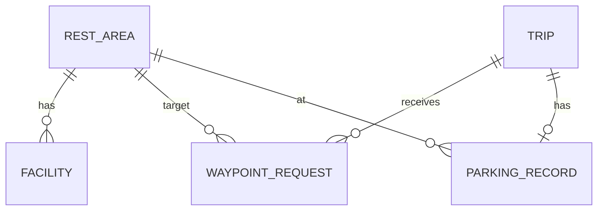
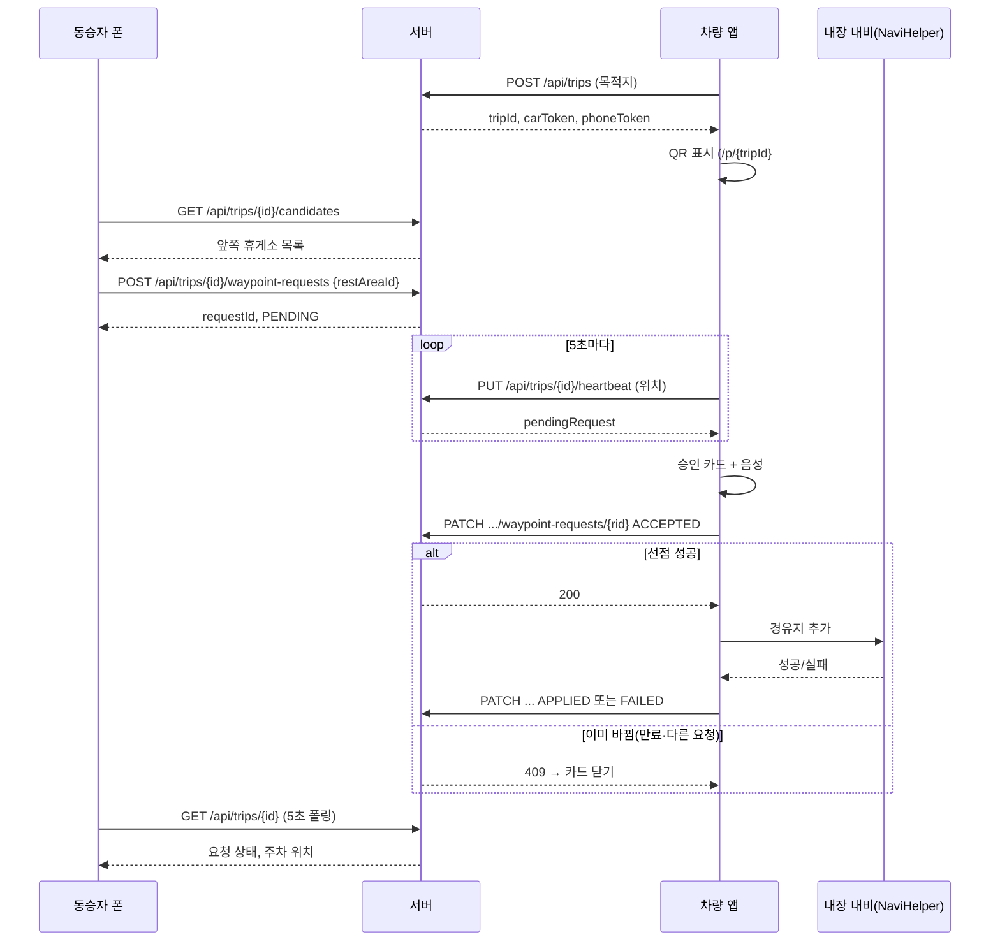
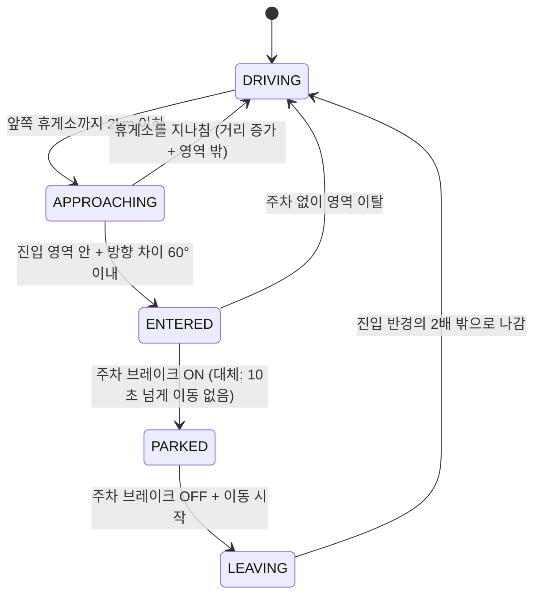
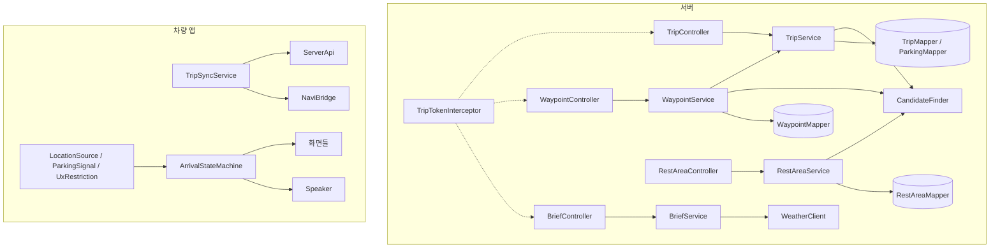

# 휴게소·도착 동반 앱 설계 문서 (v0.1, 검토용)

> 상태: **설계 검토 대기**. 승인 전에는 구현하지 않습니다.
> 대상: 현대차그룹 차량용 앱 개발 공모전 (Pleos Connect), 접수 마감 2026-11-15, 2차 PT 2026-12-03~04

---

## 0. 한 줄 요약

동승자가 **폰**에서 경로상 휴게소를 고르면 → 운전자가 **차 화면에서 한 번 눌러** 경유지로 추가하고 → 휴게소에 들어서면 차 화면에 **시설 위치**가 뜨고 → 주차하면 **주차 위치와 도보 안내가 폰으로** 이어지는 앱입니다. 목적지가 관광지라면 도착할 때 **날씨에 맞는 준비물**을 음성으로 알려줍니다.

구성 요소는 3개입니다.

| 구성 요소 | 역할 | 기술 |
|---|---|---|
| 차량 앱 | 상태 감지(접근/진입/주차/출발), 경유지 승인, 시설 안내, 음성 | Kotlin, Pleos Connect SDK |
| 폰 웹 | 경로상 휴게소 고르기, 배치도·주차 위치 보기 | 정적 HTML + JS (서버가 같이 제공) |
| 서버 | 휴게소 데이터, 차와 폰 사이 중계, 날씨 조회 | Spring Boot + MyBatis + MySQL |

---

## 1. 프로젝트 구조 (신규)

기존 코드가 없어서 "기존 구조 분석" 대신 **처음부터 지킬 구조와 규칙**을 정의합니다.

### 1.1 언어·프레임워크·버전

| 영역 | 선택 | 버전 | 근거 |
|---|---|---|---|
| 서버 언어 | Java | 21 (LTS) | 장기 지원 버전이고 record 문법을 쓸 수 있어서 DTO가 짧아집니다 |
| 서버 프레임워크 | Spring Boot | 4.1.2 (2026-10-29 확인: 3.5는 지원 종료, 4.0은 2026-12-31 종료, 4.1은 2027-07-31까지) ※ | 요청하신 Controller/Service/Mapper 계층과 그대로 맞습니다 |
| DB 접근 | MyBatis (mybatis-spring-boot-starter) | 4.1.0 (Spring Boot 4.1 지원 버전) | SQL을 직접 보며 관리할 수 있습니다. 잠금 쿼리(`FOR UPDATE`)도 명확하게 쓸 수 있습니다 |
| DB | MySQL | 8.4 LTS | 국내에서 흔하고 운영 자료가 많습니다. 공간 확장 기능은 필요 없습니다 (1.4 참고) |
| 외부 API 호출 | Spring `RestClient` | Spring 내장 | 새 라이브러리 없이 HTTP를 호출합니다 |
| 서버 빌드 | Gradle | 8.x | 차량 앱과 같은 도구를 씁니다 |
| 차량 앱 언어 | Kotlin | 2.x | 안드로이드 표준이고 공모전이 허용합니다 |
| 차량 앱 플랫폼 | Android (Pleos Connect, AAOS 기반) | minSdk 28, 에뮬레이터 API 34 | 공모전 요건(API 28 이상)과 Pleos Connect Emulator 2.1.0에 맞춥니다 |
| 차량 앱 UI | Jetpack Compose | 안정판 BOM | 상태(접근/진입/주차)에 따라 화면이 바뀌는 구조에 잘 맞습니다 |
| 차량 앱 통신 | Retrofit + OkHttp + Gson | 안정판 | 안드로이드 표준 조합이라 자료가 많습니다 |
| 차량 SDK | Pleos Connect SDK: Vehicle, NaviHelper, FusedLocation, TextToSpeech | 문서 기준 최신 (NaviHelper 3.0.5 확인) | 공모전 심사 항목 '기술 활용성'에 해당합니다 |
| 폰 화면 | 정적 HTML + 순수 JavaScript | — | 앱을 설치할 필요가 없습니다(QR → 브라우저). 빌드 도구도 필요 없습니다 |

※ Spring Boot 버전은 착수 날(2026-10-29) 지원 종료일을 확인하고 고정했습니다. 2027-02 전시 기간까지 지원되는 버전입니다.

**의도적으로 쓰지 않는 것:** Spring Security, WebSocket, Redis, Lombok, MapStruct, 프런트 프레임워크(React 등), Firebase. 왜 빼는지는 3.1과 4장에 적었습니다.

### 1.2 저장소·패키지 구조

저장소 하나에 폴더 두 개를 둡니다.

```
/server                      Spring Boot (폰 웹 정적 파일 포함)
/car-app                     Android 차량 앱
/docs                        이 문서, API 예시
```

**서버 패키지**는 계층별(controller/service/...)이 아니라 **기능별**로 나눕니다. 근거: 기능이 4개뿐이라 기능별로 묶으면 관련 파일이 한 폴더에 모여 찾기 쉽습니다. 계층은 각 기능 폴더 안에서 클래스 이름으로 구분합니다.

```
com.restmate
├── common/          ErrorCode, BusinessException, GlobalExceptionHandler, ErrorResponse, HealthController(/health: 서버·DB 연결 확인)
├── auth/            TripTokenInterceptor, TokenHasher, TripRole
├── config/          WebConfig (인터셉터 등록), 스케줄 설정
├── restarea/        RestAreaController, RestAreaService, RestAreaMapper, CandidateFinder, dto/, RestArea, Facility
├── trip/            TripController, TripService, TripMapper, ParkingMapper, dto/, Trip, ParkingRecord
├── waypoint/        WaypointController, WaypointService, WaypointMapper, dto/, WaypointRequest
└── brief/           BriefController, BriefService, WeatherClient, KmaGridConverter, dto/
resources/
├── mapper/*.xml     MyBatis SQL
├── db/schema.sql, db/seed.sql
└── static/p/        폰 웹 (index.html, app.js, style.css, layouts/*.png)
```

**차량 앱 패키지** (Gradle 모듈 하나)

```
com.restmate.car
├── state/       ArrivalStateMachine (SDK에 의존하지 않는 순수 Kotlin → 단위 테스트 가능)
├── signal/      LocationSource(FusedLocation), ParkingSignal(Vehicle Brake), NaviBridge(NaviHelper), UxRestriction
├── api/         ServerApi (Retrofit), dto
├── trip/        TripSyncService (포그라운드 서비스: 5초 heartbeat, 승인 요청 수신)
├── voice/       Speaker (TTS)
└── ui/          IdleScreen(QR), ApproachCard, EntryCard, ParkedScreen, WaypointApprovalCard
```

### 1.3 계층별 책임 (서버)

| 계층 | 하는 일 | 하지 않는 일 |
|---|---|---|
| Controller | URL 매핑, 입력 검증(`@Valid`), DTO ↔ 서비스 호출 | 비즈니스 판단, SQL |
| Service | 비즈니스 규칙, 트랜잭션 경계(`@Transactional`), 여러 Mapper 조합 | HTTP 개념(요청 헤더 등) |
| Mapper (인터페이스 + XML) | SQL 한 개 = 메서드 한 개 | 판단 로직 |
| Entity | DB 한 행을 담는 클래스 (Trip, WaypointRequest 등) | API 응답으로 그대로 노출 |
| DTO | API 요청·응답 모양 (Java record, `XxxRequest`/`XxxResponse`) | DB 컬럼을 그대로 따라가기 |

Entity와 DTO를 나누는 이유: 토큰 해시 같은 DB 컬럼이 실수로 응답에 섞여 나가지 않게 하려는 것입니다. 변환은 DTO의 정적 메서드 `from(entity)`로 직접 씁니다. 변환 라이브러리는 쓰지 않습니다.

### 1.4 데이터베이스 테이블과 관계



| 테이블 | 주요 컬럼 | 설명 |
|---|---|---|
| `rest_area` | id, name, route_name, direction_label(예: 서울방향), lat, lng, travel_bearing(진입 차량 진행 방향, 0~359°), entry_radius_m, layout_image_path, layout_w, layout_h, updated_at | 휴게소 1곳 = 상·하행 각각 1행 |
| `facility` | id, rest_area_id(FK), type(TOILET/FOOD_COURT/STORE/FUEL/EV_CHARGER/NURSING_ROOM), name, layout_x, layout_y, open_hours, note | 배치도 위 좌표(픽셀) |
| `trip` | id(BIGINT PK), public_id(CHAR(32) UNIQUE), car_token_hash, phone_token_hash, status(ACTIVE/ENDED), dest_name, dest_lat, dest_lng, last_lat, last_lng, last_heading, last_reported_at, created_at, expires_at | 여행 1건 = 차와 폰을 잇는 단위 |
| `waypoint_request` | id, trip_id(FK), rest_area_id(FK), status(PENDING/ACCEPTED/APPLIED/REJECTED/FAILED/EXPIRED), requested_at, decided_at, fail_reason | 동승자 요청 → 운전자 결정 |
| `parking_record` | trip_id(PK, FK), rest_area_id(NULL 가능), lat, lng, parked_at | 여행당 마지막 주차 위치 1건 |

공간 확장(GIS)을 쓰지 않는 이유: MVP의 휴게소는 3~5곳이고, 전국으로 넓혀도 수백 행입니다. 서버 시작 때 전부 메모리에 올려 Java로 거리를 계산하는 게 더 단순하고 빠릅니다.

위치 기록은 **마지막 위치 한 개만** 저장하고 이동 경로 이력은 남기지 않습니다. 개인 위치정보를 최소한으로 보관하려는 결정입니다.

### 1.5 API 호출 흐름과 데이터 흐름

```mermaid
flowchart LR
    subgraph Car[차량]
      SDK[Pleos SDK<br/>위치·주차브레이크·내비] --> CarApp[차량 앱]
    end
    CarApp -- "heartbeat 5초<br/>(위치 올리기 + 대기 요청 받기)" --> Server[(서버 + MySQL)]
    Phone[동승자 폰 웹] -- "후보 조회·요청·상태 폴링 5초" --> Server
    Server -- 단기예보 --> KMA[기상청 API]
    CarApp -- "QR 표시" -.-> Phone
```

- 차와 폰은 서로 직접 통신하지 않고 **둘 다 서버와만** 통신합니다.
- 실시간 전달은 **폴링(5초)**으로 합니다. 근거는 3.1에 있습니다.

### 1.6 공통 기능 (처음부터 만들고 재사용)

| 공통 기능 | 내용 |
|---|---|
| `ErrorCode` enum | 코드, HTTP 상태, 사용자용 메시지를 한곳에서 관리 |
| `BusinessException` | `ErrorCode`를 담는 런타임 예외 하나만 둡니다 |
| `GlobalExceptionHandler` | 모든 예외를 `ErrorResponse {code, message}`로 변환 |
| `TripTokenInterceptor` | 경로의 tripId와 `Authorization: Bearer` 토큰을 확인하고 역할(CAR/PHONE)을 요청 속성에 넣습니다 |
| `TokenHasher` | SHA-256 해시와 상수 시간 비교 |
| `Geo` (서버, 차량 앱 각각) | 거리(하버사인), 방위각, 각도 차이 계산. 순수 함수 |

### 1.7 예외·트랜잭션·인증 방식 요약

- **예외:** 업무 오류는 `BusinessException(ErrorCode)`, 입력 오류는 `@Valid` 실패, 나머지는 500. 응답 모양은 한 가지(`{code, message}`)입니다.
- **트랜잭션:** 행을 2개 이상 바꾸는 서비스 메서드에만 `@Transactional`을 붙입니다. 한 행만 바꾸는 쿼리는 자동 커밋으로 둡니다.
- **인증:** 회원가입이나 로그인이 없습니다. 여행을 만들 때 서버가 **차용 토큰과 폰용 토큰**을 하나씩 발급하고, 그 여행에서만 유효합니다. DB에는 해시만 저장합니다.

### 1.8 코딩 규칙

| 항목 | 규칙 |
|---|---|
| 이름 | 클래스 PascalCase, 메서드·변수 camelCase, DB 테이블·컬럼 snake_case, MyBatis `map-underscore-to-camel-case: true` |
| DTO | Java record, `XxxRequest` / `XxxResponse`, 패키지 `기능/dto` |
| SQL | 모두 Mapper XML에 씁니다(애너테이션 SQL 금지). `SELECT *` 금지. 상태 변경은 `WHERE status = ?` 조건을 붙인 조건부 UPDATE |
| 시간 | DB와 서버는 UTC, 화면에서만 KST로 표시합니다 |
| 로그 | INFO 이상 로그에 좌표와 토큰을 남기지 않습니다. tripId는 남겨도 됩니다 |
| 주석 | 코드만 봐서는 알 수 없는 **이유**만 한 줄로 씁니다 |
| 한계가 있는 임시 구현 | `// shortcut: <한계>, <언제 바꿀지>` 형식으로 표시합니다 |
| 테스트 | 계산 로직(후보 찾기, 상태 머신, 날씨 규칙, 격자 변환)은 반드시 단위 테스트를 둡니다 |

---

## 2. 요구사항 분석

### 2.1 핵심 기능과 세부 기능

| # | 핵심 기능 | 세부 기능 | MVP |
|---|---|---|---|
| F1 | 차-폰 연결 | 여행 생성, QR 표시, 폰 접속, 여행 종료 | ✅ |
| F2 | 경로상 휴게소 고르기 (폰) | 진행 방향 앞쪽 휴게소 목록, 거리와 예상 시간, 시설 아이콘 | ✅ |
| F3 | 경유지 요청과 승인 | 폰이 요청 → 차에 카드 표시 → 운전자 승인 또는 거절 → 내비에 경유지 추가 → 폰에 결과 표시 | ✅ |
| F4 | 휴게소 상태 안내 (차) | 접근 → 진입 → 주차 → 출발, 상태별 화면과 음성 | ✅ |
| F5 | 주차 위치·도보 안내 (폰) | 주차하면 자동 저장, 배치도 위에 주차 위치와 시설 표시 | ✅ |
| F6 | 도착 브리핑 | 목적지 도착 약 10분 전에 날씨를 조회하고 준비물을 음성으로 안내 | ✅ (규칙 4~5개) |
| — | 일반 도로 식당·주유소, 혼잡도, 주문, 계정 | 확장 단계 | ❌ |

### 2.2 사용자 행동별 처리 흐름

1. **운전자가 앱을 켭니다.** 차량 앱이 여행을 만들고(목적지는 NaviHelper에서 읽습니다) QR을 보여줍니다.
2. **동승자가 QR을 찍습니다.** 폰 브라우저에서 `/p/{tripId}#t={phoneToken}`이 열립니다.
3. **동승자가 휴게소 목록을 봅니다.** 서버가 차의 마지막 위치와 진행 방향, 목적지를 기준으로 앞쪽 휴게소를 계산합니다.
4. **동승자가 "여기 들르자"를 누릅니다.** 요청이 PENDING으로 저장됩니다.
5. **차량 앱이 다음 heartbeat 응답에서 요청을 받습니다.** "○○휴게소를 경유지로 추가할까요?" 카드와 음성이 나옵니다. 버튼은 2개입니다.
6. **운전자가 승인합니다.** 서버에 ACCEPTED를 먼저 기록하고 NaviHelper로 경유지를 추가한 뒤, 성공하면 APPLIED, 실패하면 FAILED로 기록합니다. 폰에 결과가 표시됩니다.
7. **휴게소에 접근합니다** (약 2km 전). 시설 요약 카드가 나옵니다.
8. **진입합니다.** 아이콘 3개와 방향 한 줄을 보여주고 음성으로 안내합니다(주행 중 규제에 맞춤).
9. **주차합니다.** 주차 위치를 저장합니다. 차 화면에는 배치도 전체를, 폰에는 배치도와 주차 위치를 보여줍니다.
10. **출발합니다.** 화면이 기본 상태로 돌아가고, 다음 휴게소를 고를 수 있습니다.
11. **목적지 근처에 오면** 도착 브리핑을 음성으로 안내합니다.
12. **여행이 끝나면** 차량 앱이 여행을 종료합니다. 서버는 위치 정보를 지웁니다.

### 2.3 입력·출력·데이터 변경

| 행동 | 입력 | 출력 | 변경되는 데이터 |
|---|---|---|---|
| 여행 생성 | 목적지(이름, 좌표) | tripId, carToken, phoneToken, 폰 URL | trip INSERT |
| heartbeat | 위치, 방향, 보고 시각, (바뀌었으면) 목적지 | 대기 중인 요청 1건 또는 없음 | trip.last_* UPDATE |
| 후보 조회 | — | 휴게소 목록 | 없음 |
| 경유지 요청 | restAreaId | requestId, status | 이전 PENDING을 EXPIRED로, 새 요청 INSERT |
| 운전자 결정 | ACCEPTED / REJECTED / APPLIED / FAILED, 실패 이유 | 바뀐 status | waypoint_request UPDATE |
| 주차 저장 | 좌표, restAreaId(있으면) | — | parking_record UPSERT |
| 도착 브리핑 | — | 안내 문장, 날씨 요약 | 없음 (메모리 캐시) |
| 여행 종료 | — | — | trip.status=ENDED, 위치 컬럼 NULL, parking_record DELETE |

### 2.4 정상 처리와 예외 상황

| 상황 | 처리 |
|---|---|
| 폰이 없는 상태로 운전 | F4(휴게소 안내)와 F6(도착 브리핑)은 폰 없이도 동작합니다. 차량 앱은 폰이 없어도 완전히 동작해야 합니다 |
| 터널 등에서 통신이 끊김 | 차량 앱은 상태 머신과 로컬에 캐시한 휴게소 데이터로 계속 안내합니다. heartbeat는 다시 연결되면 이어서 보냅니다 |
| 운전자가 카드에 반응하지 않음 | 60초 뒤 카드를 닫고 요청을 EXPIRED로 바꿉니다. 폰에 "운전자가 확인하지 못했어요"를 표시합니다 |
| 이미 지나친 휴게소를 요청 | 서버가 요청을 받을 때 후보 목록에 있는지 다시 확인하고, 없으면 거절합니다 (`REST_AREA_NOT_AHEAD`) |
| 내비 경유지 추가 실패 | FAILED와 이유를 기록하고 폰에 표시합니다 |
| 휴게소에 들어갔다가 주차하지 않고 나감 | 진입 → 기본 상태로 돌아가고, 주차 위치는 저장하지 않습니다 |
| 상·하행이 붙어 있는 휴게소 | `travel_bearing`과 진행 방향의 차이가 60° 이내일 때만 진입으로 판단합니다 |
| 날씨 API 실패 | 날씨 없이 "목적지에 곧 도착해요"만 안내합니다. 오류로 처리하지 않습니다 |
| 토큰이 틀리거나 만료됨 | 401. 폰은 "QR을 다시 찍어주세요"를 표시합니다 |

### 2.5 기존 기능과의 연관성
기존 앱 코드는 없습니다. 연동 대상은 **차량 기본 기능**입니다.
- **내장 내비(NaviHelper):** 목적지 읽기, 경유지 추가. 길안내 자체는 내비가 계속 맡습니다.
- **Vehicle SDK:** 주차 브레이크 상태로 주차를 판단합니다.
- **FusedLocation:** 위치, 진행 방향, 영역 진입 알림(`addProximityAlert`).
- **TTS:** 음성 안내.
- **화면 분할(Window Policy):** 앱은 보조 창(1:1 또는 2:1)에서 실행되는 것을 기본으로 가정합니다.

### 2.6 데이터 정합성·동시성 문제

| 문제 | 예시 | 대책 |
|---|---|---|
| 동시에 요청 | 동승자 2명이 거의 동시에 서로 다른 휴게소를 요청 | trip 행을 `SELECT ... FOR UPDATE`로 잠가 순서대로 처리합니다. 마지막 요청만 PENDING으로 남고 앞 요청은 EXPIRED가 됩니다 |
| 결정과 새 요청이 겹침 | 운전자가 A를 승인하는 순간 동승자가 B를 요청 | 결정은 `UPDATE ... WHERE id=? AND status='PENDING'`으로 합니다. 바뀐 행이 0이면 409를 돌려주고 차는 경유지를 추가하지 않습니다 |
| 경유지를 추가했는데 기록이 실패 | 내비에는 추가됐는데 서버 상태가 PENDING으로 남음 | **먼저 선점(ACCEPTED), 그다음 내비 호출** 순서를 지킵니다. 내비 호출 뒤 APPLIED/FAILED 기록이 실패하면 차량 앱이 다음 heartbeat 때 다시 보냅니다 |
| 위치 보고 순서가 바뀜 | 재전송으로 오래된 위치가 나중에 도착 | `WHERE last_reported_at IS NULL OR last_reported_at < #{reportedAt}` 조건으로 더 최신일 때만 갱신합니다 |
| 같은 요청이 중복됨 | 폰에서 버튼을 두 번 누르거나 재시도 | 같은 휴게소에 PENDING 요청이 이미 있으면 새로 만들지 않고 기존 요청을 돌려줍니다 |

### 2.7 성능·보안 고려사항
- **부하:** 운행 중인 차 1대당 5초마다 heartbeat 1회와 폰 폴링 1회가 생깁니다. 공모전 규모에서는 문제가 되지 않습니다. 1,000대가 동시에 운행해도 초당 약 400건의 단순 쿼리이고, MySQL 한 대로 감당할 수 있는 수준으로 판단합니다(부하 테스트는 하지 않았습니다).
- **휴게소 데이터:** 서버 시작 때 메모리에 올립니다. 바뀌지 않는 데이터라 매번 DB를 조회할 필요가 없습니다.
- **보안:** HTTPS만 허용합니다. 토큰은 32바이트 난수이고 DB에는 SHA-256 해시만 저장합니다. 폰 토큰은 URL의 `#` 뒤(fragment)에 넣어서 서버 접속 로그와 Referer에 남지 않게 합니다. 좌표는 범위를 검증합니다. 위치 보관은 최소한으로 합니다(2.3, 5장).
- **법적 사항:** 위치정보를 다루므로 실제 서비스 전에 위치정보법에 따른 사업 신고가 필요한지 확인해야 합니다. 공모전 데모 단계에서는 해당하지 않는다고 보지만, 확인은 하지 않았습니다.

### 2.8 추가 확인이 필요한 요구사항 (결정 필요)

괄호 안은 별도 의견이 없을 때 이 문서가 가정한 기본값입니다.

| # | 질문 | 기본값 | 영향 |
|---|---|---|---|
| Q1 | 동승자 폰을 여러 대 연결해도 되나요? | 허용. 마지막 요청이 우선 | 동시성 처리 방식 |
| Q2 | 경유지 후보는 휴게소만인가요, 일반 도로 식당·주유소도 포함인가요? | MVP는 휴게소만 (휴게소 안 주유소·충전소 포함) | 외부 장소 API 도입 여부 |
| Q3 | 운전자 승인 없이 경유지를 바로 추가해도 되나요? | **승인 필수** (운전자 통제권과 심사 안전성) | 화면 흐름 |
| Q4 | 회원 계정이 필요한가요? | 필요 없음. 여행 단위 토큰 사용 | 인증 구조 전체 |
| Q5 | 도착 브리핑을 MVP에 넣나요? | 넣음 (규칙 4~5개) | 기상청 API 연동 |
| Q6 | 휴게소가 아닌 곳의 주차 위치도 저장하나요? | 저장함 (restAreaId 없이 좌표만) | parking_record의 rest_area_id를 NULL 허용으로 둠 |
| Q7 | 위치 데이터를 얼마나 보관하나요? | 여행 종료 즉시 삭제, 최대 24시간 | 정리 배치 |
| Q8 | 배치도를 만들 휴게소는 몇 곳이고 어디인가요? | 3~5곳 (데모 경로상) | 데이터 작업량 |

**Pleos SDK에서 확인할 것** (10/28 설명회 질문):
- S1: NaviHelper로 경유지를 추가하면 내비가 자체 확인 창을 띄우나요?
- S2: NaviHelper로 경로 좌표(폴리라인)를 받을 수 있나요?
- S3: 주차 브레이크나 기어(P단) 신호를 받을 수 있나요?
- S4: 앱이 백그라운드(포그라운드 서비스)에서 통신을 계속할 수 있나요? 보조 창에 자동으로 뜰 수 있나요?

S2와 S4는 설계에 직접 영향을 줍니다. 대안은 4.2와 11장에 있습니다.

---

## 3. 설계안

### 3.1 설계 방향과 주요 결정

| 결정 | 선택 | 대안과 비교 | 근거 |
|---|---|---|---|
| D1 차-폰 연결 방식 | **서버 중계 + 폴링** | WebSocket/SSE: 즉시 전달되지만 연결 유지, 재연결, 로드밸런서 설정이 필요합니다. FCM 푸시: 차량(AAOS)에 Google 서비스가 없을 수 있습니다. 블루투스·같은 Wi-Fi 직접 연결: 차량 권한이 불확실하고 iOS 웹에서 쓸 수 없습니다 | 경유지 요청은 몇 초 늦어도 문제가 없습니다. 폴링은 어떤 네트워크에서도 동작하고, 테스트와 장애 분석이 가장 쉽습니다 |
| D2 차의 폴링 횟수 줄이기 | **heartbeat 하나로 위치 보고와 요청 수신을 동시에** | 위치 API와 요청 조회 API를 따로 두면 호출이 2배가 됩니다 | 호출 수와 코드가 모두 줄어듭니다 |
| D3 폰 화면 | **서버가 제공하는 정적 웹** | 네이티브 앱은 설치 과정이 있어서 차 안에서 QR을 찍고 바로 쓰는 흐름이 깨집니다 | 설치가 필요 없고 빌드 도구도 필요 없습니다 |
| D4 인증 | **여행 단위 토큰 + 인터셉터** | Spring Security + 회원 계정: MVP에 필요 없는 로그인 화면, 세션, 비밀번호 관리가 생깁니다 | 토큰 2개, 확인 장소 1곳으로 충분합니다 |
| D5 경로상 후보 계산 | **진행 방향과 목적지 기준 근사** (4.2) | 내비 경로 좌표 사용: 가장 정확하지만 SDK 지원 여부를 모릅니다(S2) | 지금 확실히 받을 수 있는 데이터(위치, 방향, 목적지)만 씁니다. S2가 확인되면 `CandidateFinder` 안쪽만 바꿉니다 |
| D6 상태 판단 위치 | **차량 앱 안 (`ArrivalStateMachine`)** | 서버 판단: 터널이나 통신 두절 때 안내가 멈춥니다 | 안전 관련 안내는 네트워크 없이도 동작해야 합니다 |
| D7 경유지 추가 순서 | **서버에 선점 → 내비 호출 → 결과 기록** | 내비 먼저 호출: 서버 기록과 내비 상태가 어긋날 수 있습니다 | 2.6 동시성 표 참고 |
| D8 날씨 규칙 | **if 문 4~5개를 한 메서드에** | 규칙 엔진, DB 규칙 테이블 | 규칙이 적고 거의 바뀌지 않습니다 |
| D9 휴게소 데이터 입력 | **SQL seed와 배치도 이미지 파일** | 관리자 화면: MVP에서 쓸 사람이 개발자뿐입니다 | 확장 단계(운영사 직접 등록)에서 만듭니다 |

### 3.2 전체 처리 흐름

**경유지 요청·승인 (핵심 흐름)**



**휴게소 상태 머신 (차량 앱)**



| 상태 | 차 화면 (보조 창) | 음성 | 서버 호출 |
|---|---|---|---|
| DRIVING | QR + "다음 휴게소 ○○ 23km" | — | heartbeat |
| APPROACHING | 시설 아이콘 요약 카드 | "곧 ○○휴게소입니다" | 휴게소 상세 (캐시 없을 때) |
| ENTERED | 아이콘 3개 + 방향 한 줄 (주행 중 규제 준수) | "화장실은 건물 왼쪽" | — |
| PARKED | 배치도 전체 + 주차 위치 | — | PUT parking |
| LEAVING | 기본 화면으로 복귀 | — | — |

빠르게 상태가 오락가락하는 것을 막기 위해 들어갈 때와 나올 때 기준을 다르게 둡니다(진입 반경 r, 이탈 반경 2r).

### 3.3 기능별 책임과 모듈 구성



| 모듈 | 책임 |
|---|---|
| restarea | 휴게소·시설 조회, 메모리 캐시, 후보 계산(`CandidateFinder`) |
| trip | 여행 생성·종료, 토큰 발급, heartbeat, 주차 위치 |
| waypoint | 요청 생성, 선점과 결정, 만료 처리 |
| brief | 날씨 조회와 안내 문장 만들기 |
| auth | 토큰 확인, 역할 구분 |
| 차량 state | 신호 → 상태 전환 (순수 로직) |
| 차량 signal | Pleos SDK 호출을 감싸서 상태 머신에 단순한 값(위치, 주차 여부)으로 넘김 |
| 차량 trip | 포그라운드 서비스로 heartbeat 보내기, 요청 받기, 승인 결과 보내기 |

### 3.4 API 설계

공통 규칙:
- 경로는 `/api/...`이고 JSON을 씁니다.
- 인증은 `Authorization: Bearer <token>`입니다. 각 API가 허용하는 역할은 표에 있습니다.
- 성공 응답은 DTO를 그대로 돌려줍니다(감싸는 공통 객체 없음). 실패 응답은 `{ "code": "...", "message": "..." }`입니다.

| # | 메서드·경로 | 역할 | 요청 | 응답 |
|---|---|---|---|---|
| A1 | `POST /api/trips` | 없음 (여행 생성) | `{destName, destLat, destLng}` | 201 `{tripId, carToken, phoneToken, phoneUrl}` |
| A2 | `PUT /api/trips/{tripId}/heartbeat` | CAR | `{lat, lng, heading, reportedAt, dest?}` | 200 `{pendingRequest: {requestId, restAreaId, restAreaName, requestedAt} \| null}` |
| A3 | `POST /api/trips/{tripId}/end` | CAR | — | 204 |
| A4 | `GET /api/trips/{tripId}` | CAR, PHONE | — | 200 `{status, destName, lastReportedAt, latestRequest, parking}` |
| A5 | `GET /api/trips/{tripId}/candidates` | PHONE | — | 200 `[{restAreaId, name, directionLabel, distanceKm, etaMin, facilityTypes[]}]` |
| A6 | `POST /api/trips/{tripId}/waypoint-requests` | PHONE | `{restAreaId}` | 201 `{requestId, status}` (같은 휴게소가 이미 대기 중이면 200과 기존 요청) |
| A7 | `PATCH /api/trips/{tripId}/waypoint-requests/{requestId}` | CAR | `{status: ACCEPTED\|REJECTED\|APPLIED\|FAILED, failReason?}` | 200 `{requestId, status}` / 409 |
| A8 | `PUT /api/trips/{tripId}/parking` | CAR | `{lat, lng, restAreaId?, parkedAt}` | 204 |
| A9 | `GET /api/trips/{tripId}/arrival-brief` | CAR | — | 200 `{message, weather: {tempC, rainProb, uvLevel} \| null}` |
| A10 | `GET /api/rest-areas/{id}` | 없음 (공개 데이터) | — | 200 `{id, name, directionLabel, lat, lng, travelBearing, entryRadiusM, layoutImageUrl, layoutW, layoutH, facilities[]}` |

허용하는 상태 전이 (A7):

```
PENDING  → ACCEPTED | REJECTED | EXPIRED
ACCEPTED → APPLIED | FAILED
```
그 밖의 전이는 409 `INVALID_STATUS_TRANSITION`입니다. 같은 상태로 다시 보내면(재시도) 200을 돌려줍니다. 그래서 재전송해도 안전합니다.

요청·응답 예시 (A2):

```json
// 요청
{ "lat": 37.2411, "lng": 127.2103, "heading": 152, "reportedAt": "2026-11-20T03:12:05Z" }
// 응답
{ "pendingRequest": { "requestId": 81, "restAreaId": 12, "restAreaName": "덕평자연휴게소(강릉방향)", "requestedAt": "2026-11-20T03:11:58Z" } }
```

오류 코드:

| code | HTTP | 언제 |
|---|---|---|
| `INVALID_INPUT` | 400 | 검증 실패 (좌표 범위 등) |
| `INVALID_TOKEN` | 401 | 토큰이 없거나 틀림 |
| `ROLE_NOT_ALLOWED` | 403 | 폰 토큰으로 차 전용 API를 호출함 |
| `TRIP_NOT_FOUND`, `REST_AREA_NOT_FOUND`, `REQUEST_NOT_FOUND` | 404 | 대상이 없음 |
| `TRIP_ENDED` | 409 | 끝난 여행에 쓰기 |
| `REST_AREA_NOT_AHEAD` | 409 | 지나친 휴게소를 요청 |
| `INVALID_STATUS_TRANSITION` | 409 | 2.6, A7 참고 |

### 3.5 DB 변경 사항과 SQL 설계 방향

신규 스키마 (`db/schema.sql`) 핵심 부분:

```sql
CREATE TABLE trip (
  id               BIGINT AUTO_INCREMENT PRIMARY KEY,
  public_id        CHAR(32)     NOT NULL UNIQUE,      -- URL용. 순번 노출을 막습니다
  car_token_hash   CHAR(64)     NOT NULL,
  phone_token_hash CHAR(64)     NOT NULL,
  status           VARCHAR(10)  NOT NULL,             -- ACTIVE / ENDED
  dest_name        VARCHAR(100),
  dest_lat DECIMAL(9,6), dest_lng DECIMAL(9,6),
  last_lat DECIMAL(9,6), last_lng DECIMAL(9,6), last_heading SMALLINT,
  last_reported_at DATETIME(3),
  created_at       DATETIME(3)  NOT NULL,
  expires_at       DATETIME(3)  NOT NULL,
  INDEX idx_trip_expires (status, expires_at)
);

CREATE TABLE waypoint_request (
  id            BIGINT AUTO_INCREMENT PRIMARY KEY,
  trip_id       BIGINT      NOT NULL,
  rest_area_id  BIGINT      NOT NULL,
  status        VARCHAR(10) NOT NULL,
  requested_at  DATETIME(3) NOT NULL,
  decided_at    DATETIME(3),
  fail_reason   VARCHAR(200),
  CONSTRAINT fk_wr_trip FOREIGN KEY (trip_id) REFERENCES trip(id),
  CONSTRAINT fk_wr_ra   FOREIGN KEY (rest_area_id) REFERENCES rest_area(id),
  INDEX idx_wr_trip_status (trip_id, status)
);
```

핵심 SQL 패턴:

```sql
-- 요청 생성 (트랜잭션 안에서 순서대로)
SELECT id, status FROM trip WHERE public_id = #{publicId} FOR UPDATE;
UPDATE waypoint_request SET status = 'EXPIRED', decided_at = #{now}
 WHERE trip_id = #{tripId} AND status = 'PENDING';
INSERT INTO waypoint_request (...) VALUES (...);

-- 결정: 조건부 UPDATE (바뀐 행 수가 0이면 409)
UPDATE waypoint_request SET status = #{to}, decided_at = #{now}, fail_reason = #{reason}
 WHERE id = #{id} AND trip_id = #{tripId} AND status = #{from};

-- heartbeat: 더 최신 보고일 때만 갱신
UPDATE trip SET last_lat = #{lat}, last_lng = #{lng}, last_heading = #{heading}, last_reported_at = #{reportedAt}
 WHERE id = #{tripId} AND status = 'ACTIVE'
   AND (last_reported_at IS NULL OR last_reported_at < #{reportedAt});
```

- 대기 요청 만료(60초)는 별도 배치를 만들지 않고, heartbeat와 요청을 생성할 때 `requested_at < now - 60s`인 PENDING을 같이 EXPIRED로 바꿉니다. 스케줄러가 하나 줄어듭니다.
- 여행 정리: `@Scheduled` 1개(10분마다)로 `expires_at`이 지난 여행을 ENDED로 바꾸고 위치 컬럼을 비우고 주차 기록을 삭제합니다.

### 3.6 클래스와 메서드 책임 (주요 클래스만)

**서버**

| 클래스 | 메서드 | 책임 |
|---|---|---|
| `TripService` | `create(dest)` | 토큰 2개를 생성·해시하고 INSERT. 원문 토큰은 이 응답에서만 돌려줍니다 |
| | `heartbeat(tripId, pos)` | 위치를 갱신하고, 오래된 PENDING을 만료하고, 대기 요청 1건을 조회 |
| | `end(tripId)` | ENDED 처리, 위치 비우기, 주차 기록 삭제 (`@Transactional`) |
| | `saveParking(tripId, req)` | UPSERT (`INSERT ... ON DUPLICATE KEY UPDATE`) |
| | `getSummary(tripId)` | 여행 상태, 최근 요청, 주차 위치 |
| `WaypointService` | `request(tripId, restAreaId)` | 잠금 → 앞쪽 휴게소인지 확인 → 중복이면 기존 요청 반환 → 이전 요청 만료 → INSERT (`@Transactional`) |
| | `decide(tripId, requestId, to, reason)` | 허용 전이 확인 → 조건부 UPDATE → 바뀐 행이 0이면 현재 상태를 보고 같은 상태면 200, 아니면 409 |
| `CandidateFinder` | `findAhead(pos, heading, dest, restAreas)` | 순수 함수. 4.2 알고리즘 |
| `RestAreaService` | `get(id)`, `all()` | 시작할 때 메모리에 올린 목록 제공 |
| `BriefService` | `brief(tripId)` | 목적지 좌표 → 격자 변환 → 날씨 조회(캐시) → 규칙으로 문장 만들기 |
| `WeatherClient` | `forecast(nx, ny, at)` | 기상청 단기예보 호출. 격자와 시간 단위로 메모리 캐시 |
| `KmaGridConverter` | `toGrid(lat, lng)` | 위경도를 기상청 격자(nx, ny)로 변환 (공개된 공식) |
| `TripTokenInterceptor` | `preHandle` | tripId와 토큰을 확인하고 역할을 요청 속성에 넣습니다. 역할은 컨트롤러 메서드의 `@AllowRoles` 애너테이션으로 검사합니다 |

**차량 앱**

| 클래스 | 메서드 | 책임 |
|---|---|---|
| `ArrivalStateMachine` | `onSignal(signal): Transition?` | 입력(위치, 방향, 주차 여부, 휴게소 목록)을 받아 다음 상태를 돌려줍니다. 시간과 SDK에 의존하지 않습니다 |
| `TripSyncService` | `start()`, `stop()`, `tick()` | 5초마다 heartbeat를 보내고, 요청이 있으면 UI에 넘깁니다. 실패하면 다음 tick에 다시 시도 |
| | `approve(request)` | ACCEPTED 선점 → `NaviBridge.addWaypoint` → APPLIED/FAILED |
| `NaviBridge` | `destination()`, `addWaypoint(lat, lng, name)` | NaviHelper 호출을 감쌉니다 (SDK 콜백을 suspend 함수로 바꿈) |
| `ParkingSignal` | `isParked(): Flow<Boolean>` | 주차 브레이크 신호. 지원하지 않으면 "10초 넘게 이동 없음"으로 대체 |
| `UxRestriction` | `requiresOptimization(): Flow<Boolean>` | `CarUxRestrictionsManager` 리스너. 주행 중에는 화면을 단순한 버전으로 바꿉니다 |
| `Speaker` | `say(text)` | TTS. 같은 문장이 짧은 시간에 반복되지 않게 막습니다 |

### 3.7 기존 코드 재사용과 변경 대상
- 기존 코드가 없으므로 **변경 대상이 없습니다.**
- 외부에서 가져다 쓰는 것:
  - Pleos SDK 샘플의 초기화·해제 순서 (initialize → listener → release)
  - AAOS `CarUxRestrictionsManager` 사용 예제
  - 기상청 격자 변환 공식 (공개 코드)
  - 한국도로공사 공공데이터 (휴게소 좌표, 노선, 방향)
- 프로젝트 안에서 재사용할 것: 1.6의 공통 기능, 차량 앱과 서버의 `Geo` 계산 (언어가 달라서 각각 구현하되 같은 테스트 값을 씁니다)

### 3.8 예외 처리와 트랜잭션 범위

| 메서드 | 트랜잭션 | 이유 |
|---|---|---|
| `TripService.create` | 없음 | INSERT 1건 |
| `TripService.heartbeat` | 없음 | 위치 UPDATE와 만료 UPDATE는 서로 독립적입니다. 하나가 실패해도 다음 heartbeat 때 다시 시도됩니다 |
| `TripService.end` | **있음** | trip UPDATE와 parking DELETE를 같이 처리해야 합니다 |
| `WaypointService.request` | **있음** | 잠금, 만료, INSERT를 한 번에 처리해야 동시 요청이 꼬이지 않습니다 |
| `WaypointService.decide` | 없음 | 조건부 UPDATE 한 문장으로 원자성이 보장됩니다 |
| `BriefService.brief` | 없음 | 읽기만 하고 외부 API를 호출합니다. 외부 호출을 트랜잭션 안에 넣으면 DB 연결을 오래 잡게 됩니다 |

예외 처리:
- 외부 API(기상청)는 타임아웃 2초를 두고, 실패하면 날씨 없이 응답합니다.
- 차량 앱의 SDK 호출 실패는 사용자에게 짧게 알리고(예: "경유지 추가에 실패했어요"), 서버에 FAILED로 기록합니다.
- 차량 앱의 통신 실패는 사용자에게 알리지 않고 다시 시도합니다. 휴게소 안내는 캐시로 계속합니다.

### 3.9 성능·보안·정합성 대책 요약
- **성능:** 휴게소는 메모리 캐시, 날씨는 격자와 시간 단위 캐시(shortcut: 서버 1대 기준. 여러 대로 늘리면 공용 캐시를 검토), 폴링 간격 5초, 인덱스 2개(`trip(status, expires_at)`, `waypoint_request(trip_id, status)`).
- **보안:** HTTPS, 토큰 해시, 토큰은 fragment로 전달, 역할 검사, 입력 범위 검증, 로그에 좌표 남기지 않기, 공개 API는 휴게소 정보뿐.
- **정합성:** 잠금 1곳, 조건부 UPDATE, 선점 후 실행, 오래된 보고 무시, 중복 요청 흡수 (2.6).
- **개인정보:** 마지막 위치만 저장, 여행 종료 즉시 삭제, 최대 24시간 보관.

### 3.10 테스트 시나리오

**단위 테스트**

| 대상 | 경우 |
|---|---|
| `CandidateFinder` | 앞쪽 휴게소만 포함 / 반대 방향 휴게소 제외 / 이미 지난 휴게소 제외 / 목적지보다 먼 휴게소 제외 / 후보 0개 |
| `ArrivalStateMachine` | 정상 흐름(주행→접근→진입→주차→출발→주행) / 주차 없이 통과 / 반대 차로 휴게소 근처를 지날 때 진입하지 않음 / 경계에서 좌표가 흔들려도 상태가 오락가락하지 않음 / 주차 브레이크 신호 미지원 시 대체 판단 |
| `BriefService` 규칙 | 30℃ 이상 → 양산·모자 / 강수확률 60% 이상 → 우산 / 0℃ 이하 → 방한 / 날씨 없음 → 기본 문장 |
| `KmaGridConverter` | 기상청 공개 예시 좌표와 비교 |
| 상태 전이 표 (A7) | 허용 전이 전부 / 금지 전이 전부 / 같은 상태 재전송 |

**통합 테스트** (MyBatis 매퍼 + 서비스, H2 MySQL 모드)
- 동시 요청: 스레드 2개가 동시에 요청 → PENDING은 정확히 1건
- 결정 경합: 결정과 새 요청이 동시에 → 하나는 409
- heartbeat 순서 역전: 오래된 보고가 늦게 도착 → 위치가 바뀌지 않음
- 여행 종료 → 위치 NULL, 주차 기록 없음
- 토큰: 틀린 토큰 401, 역할 위반 403

※ H2는 MySQL과 잠금 동작이 완전히 같지 않습니다. 동시성 두 경우는 실제 MySQL(로컬 또는 스테이징)에서 한 번 더 확인합니다.

**에뮬레이터 시나리오** (Pleos Connect Emulator)
- GPX 경로 재생: 고속도로 주행 → 휴게소 진입 → 정차 → 가상 콘솔로 주차 브레이크 ON → 출발
- 폰(PC 브라우저)으로 요청 → 차 카드 → 승인 → 내비 경유지 추가 확인
- 네트워크 끊기(에뮬레이터 비행기 모드) → 휴게소 안내 계속 → 다시 연결된 뒤 heartbeat 재개
- 화면 프리셋(가로·세로, 1:1·2:1)에서 화면이 잘리지 않는지 (폼 팩터 테스트 가이드)
- 주행 중 규제 ON일 때 진입 카드가 단순한 버전으로 나오는지

**PT 데모 체크리스트:** 위 정상 흐름 1회를 처음부터 끝까지 3분 안에 보여줍니다.

### 3.11 위험 요소와 대안

| 위험 | 가능성 | 영향 | 대안 |
|---|---|---|---|
| NaviHelper가 외부 앱의 경유지 추가를 막거나 자체 확인 창을 띄움 (S1) | 중 | 높음 | 자체 확인 창이 있으면 우리 카드를 생략합니다. 막혀 있으면 "목적지 화면 요청"이나 딥링크로 내비 검색 화면을 띄웁니다 |
| 경로 좌표를 받을 수 없음 (S2) | 중 | 중 | 현재 설계(방향과 목적지 근사)를 그대로 씁니다 |
| 백그라운드 통신 제한 (S4) | 중 | 높음 | 앱이 보조 창에 떠 있을 때만 heartbeat를 보냅니다. 휴게소 안내는 영역 진입 알림(`addProximityAlert`)으로 받습니다 |
| 주차 브레이크 신호 없음 (S3) | 중 | 낮음 | "10초 넘게 이동 없음 + 주행 규제 해제"로 대체합니다 |
| 배치도 제작 시간 부족 | 높음 | 중 | 데모 경로의 휴게소 3곳으로 줄입니다. 정밀 도면이 아니라 블록과 아이콘으로 그립니다 |
| GPS 오차로 진입 판단이 틀림 | 중 | 중 | 진입 반경을 휴게소마다 조정할 수 있게 컬럼으로 둡니다(`entry_radius_m`). 방향 조건과 이탈 반경을 함께 씁니다 |
| 폴링 지연 때문에 승인 카드가 늦게 뜸 | 낮음 | 낮음 | 최대 5초 지연으로 충분합니다. 문제가 되면 폴링 간격을 2초로 줄입니다 (코드 변경 없이 설정값만) |
| 위치정보법 | 낮음 (데모) / 높음 (출시) | 높음 | 출시 전에 사업 신고 여부를 확인합니다. 최소 보관 원칙은 지금부터 적용합니다 |
| 일정 (마감 11/15, PT 12/3) | 높음 | 높음 | 11/15까지는 서버와 상태 머신, 시연 영상까지만 합니다. 나머지는 PT 전까지 진행합니다 |

---

## 4. 설계 자체 검토

### 4.1 과도한 설계가 없는가?

| 점검 | 판단 |
|---|---|
| 계층 구조 (Controller/Service/Mapper/DTO/Entity) | 요청받은 구조라 유지합니다. 다만 Service 인터페이스와 구현을 나누지 않습니다(구현이 1개뿐) |
| 기능별 패키지 6개 | 적정합니다. 더 합치면 waypoint와 trip의 경계가 흐려집니다 |
| `brief` 모듈 | MVP에서 빼도 핵심 흐름에는 영향이 없습니다. Q5 답에 따라 뺄 수 있게 독립 모듈로 두었습니다 |
| 상태 6개 (PENDING~EXPIRED) | ACCEPTED를 빼면 단순해 보이지만, 그러면 "내비 추가 중"인 상태를 표현할 수 없어서 2.6의 어긋남 문제가 생깁니다. 유지합니다 |
| 공통 응답 래퍼, Spring Security, WebSocket, Redis, 관리자 화면, GIS | **모두 뺐습니다.** 지금 요구사항에서 하는 일이 없습니다 |

### 4.2 경로상 후보 계산 (D5 상세)

휴게소 R이 후보가 되는 조건 (모두 만족해야 함):
1. 현재 위치에서 R까지 직선거리 ≤ 80km
2. 현재 진행 방향과 R의 `travel_bearing` 차이 ≤ 60° (반대 차로 휴게소 제외)
3. 현재 위치 → R 방위각과 진행 방향의 차이 ≤ 70° (뒤쪽 휴게소 제외)
4. R에서 목적지까지 거리 < 현재 위치에서 목적지까지 거리 (목적지를 지나친 곳 제외)

예상 시간 = 직선거리 × 1.2 ÷ 시속 90km. (`// shortcut: 직선 근사, 내비 경로 좌표를 받을 수 있으면(S2) 경로 거리로 교체`)

이 방식은 굽은 고속도로나 분기점에서 틀릴 수 있습니다. 그래서 서버는 요청을 받을 때 같은 조건으로 한 번 더 확인하고(2.4), 최종 판단은 운전자 승인이 맡습니다.

### 4.3 테스트·운영 환경에서 검증할 수 있는가?
- 판단 로직(후보 계산, 상태 머신, 날씨 규칙)은 전부 순수 함수라 SDK와 서버 없이 테스트할 수 있습니다.
- 서버는 폴링 방식이라 요청과 응답이 모두 일반 HTTP 로그로 남습니다. 문제가 생기면 tripId로 추적할 수 있습니다.
- 차량 쪽은 GPX 재생과 가상 콘솔로 같은 시나리오를 반복할 수 있습니다.
- 확인할 수 없는 부분은 실제 차량의 GPS 품질과 NaviHelper 실제 동작입니다(S1~S4). 설명회 답변을 받은 뒤 이 문서를 갱신합니다.

### 4.4 더 단순한 방법은 없는가?

| 대안 | 장점 | 잃는 것 | 판단 |
|---|---|---|---|
| **서버 없이** 차량 앱에 휴게소 JSON을 넣고, QR은 정적 페이지 링크로 | 서버 개발·운영이 0 | 폰→차 경유지 요청(F3)과 폰의 주차 위치(F5)가 불가능. 핵심 차별점이 사라짐 | 채택하지 않음 |
| 폰 연동만 빼고 차량 앱만 만들기 | 일정 부담이 절반 | "하차 후 화면이 안 보이는" 문제가 그대로 남음 | **일정이 부족하면 쓸 1단계 범위**로 남겨둡니다 |
| 서버를 Firebase로 | 서버 코드 감소 | 요청하신 계층 구조와 다르고, 차량에 Google 서비스가 없을 수 있음 | 채택하지 않음 |

결론: 현재 설계가 핵심 기능(F1~F5)을 지키는 가장 작은 구성이라고 판단합니다. 일정이 부족할 때 줄이는 순서는 **F6 → F5(폰 쪽) → F3** 입니다.

---

## 5. 승인 요청 사항

아래를 확인해 주시면 구현 계획(작업 순서와 일정)으로 넘어가겠습니다.
1. 2.8의 Q1~Q8 기본값을 그대로 써도 되는지
2. 3.1의 주요 결정 D1(폴링), D3(폰 웹), D4(계정 없음)에 동의하는지
3. MVP 범위 F1~F6과 줄이는 순서(F6 → F5 → F3)
