# WAY:ON ERD

> 기준: [way-on.md](way-on.md) (통합 설계). 2026-11-05 추가·변경 이유는 way-on.md 8장
> DB: MySQL 8.4, utf8mb4, 시간은 모두 UTC
> DDL: `server/src/main/resources/db/schema.sql` (이 문서와 같은 구조. 테이블·컬럼 한글 이름은 `COMMENT`에 있음)

```mermaid
erDiagram
    VEHICLE ||--o{ PASSENGER : "등록된 동승자"
    VEHICLE ||--o{ CONNECT_CODE : "일회용 연결 코드"
    VEHICLE ||--o{ TRIP : "주행 세션"
    TRIP ||--o{ TRIP_PASSENGER : "이번 세션 연결"
    PASSENGER ||--o{ TRIP_PASSENGER : "참여"
    TRIP ||--o{ WAYPOINT_REQUEST : "요청을 받음"
    PASSENGER ||--o{ WAYPOINT_REQUEST : "요청함"
    REST_AREA ||--o{ FACILITY : "시설을 가짐"
    REST_AREA ||--o{ REST_AREA_BRAND : "프랜차이즈 매장"
    REST_AREA ||--o{ REST_AREA_MENU : "메뉴"
    REST_AREA ||--o{ REST_AREA_TOP_ITEM : "판매 Top5"
    REST_AREA ||--o{ REST_AREA_PLACE : "지도 장소"
    REST_AREA_MENU |o--o{ REST_AREA_TOP_ITEM : "가격 연결"
    EV_STATION ||--o{ EV_CHARGER : "충전기"
    VEHICLE ||--o{ DEPARTURE_CALL : "출발 알림"
    TRIP ||--o{ DEPARTURE_CALL : "누른 세션"
    DEPARTURE_CALL ||--o{ DEPARTURE_MESSAGE : "대화"
    PASSENGER |o--o{ DEPARTURE_MESSAGE : "보냄 (NULL이면 운전자)"

    VEHICLE {
        BIGINT id PK
        CHAR(32) public_id UK
        CHAR(64) car_token_hash UK "차량 토큰 SHA-256"
        DATETIME(3) created_at
        DATETIME(3) last_seen_at "NULL 가능"
    }

    PASSENGER {
        BIGINT id PK
        BIGINT vehicle_id FK
        CHAR(64) reconnect_token_hash UK "재연결 토큰 SHA-256"
        VARCHAR(10) nickname "닉네임, 연결 때 필수. 같은 차 안에서 겹치지 않음"
        DATETIME(3) created_at
        DATETIME(3) last_connected_at "NULL 가능"
        DATETIME(3) revoked_at "해제 시각, NULL이면 유효"
        VARCHAR(500) push_endpoint "Web Push 구독, NULL이면 알림 꺼짐"
        VARCHAR(100) push_p256dh "NULL 가능"
        VARCHAR(50) push_auth "NULL 가능"
        DATETIME(3) push_updated_at "NULL 가능"
    }

    CONNECT_CODE {
        BIGINT id PK
        BIGINT vehicle_id FK
        VARCHAR(5) kind "QR, PIN"
        CHAR(64) code_hash
        DATETIME(3) expires_at "짧은 만료"
        DATETIME(3) used_at "NULL이면 미사용"
        SMALLINT fail_count "PIN 시도 횟수 제한용"
    }

    TRIP {
        BIGINT id PK
        CHAR(32) public_id UK
        BIGINT vehicle_id FK
        VARCHAR(10) status "ACTIVE, ENDED, EXPIRED"
        DATETIME(3) car_consented_at "차량 쪽 위치 공유 동의, NULL 가능"
        VARCHAR(100) dest_name "NULL 가능"
        DECIMAL(9_6) dest_lat "NULL 가능"
        DECIMAL(9_6) dest_lng "NULL 가능"
        DECIMAL(9_6) last_lat "종료 시 NULL"
        DECIMAL(9_6) last_lng "종료 시 NULL"
        SMALLINT last_heading "NULL 가능"
        DATETIME(3) last_reported_at "NULL 가능"
        VARCHAR(5) energy_type "EV, FUEL, NULL 가능"
        TINYINT energy_pct "화면 표시용, NULL 가능"
        INT range_m "주행 가능 거리(m), 에너지 제안 기준, NULL 가능"
        DATETIME(3) low_energy_alerted_at "중복 제안 방지, NULL 가능"
        DATETIME(3) created_at
        DATETIME(3) last_activity_at "5분 무통신 만료 기준"
        DATETIME(3) ended_at "NULL 가능"
    }

    TRIP_PASSENGER {
        BIGINT trip_id PK, FK
        BIGINT passenger_id PK, FK
        DATETIME(3) joined_at
        DATETIME(3) consented_at "폰 쪽 위치 공유 동의"
    }

    WAYPOINT_REQUEST {
        BIGINT id PK
        BIGINT trip_id FK
        BIGINT passenger_id FK
        VARCHAR(15) place_type "REST_AREA, EV_CHARGER, GAS_STATION, RESTAURANT, PARKING"
        VARCHAR(50) place_ext_id "외부 데이터 ID, NULL 가능"
        VARCHAR(100) poi_name
        VARCHAR(200) address "NULL 가능"
        DECIMAL(9_6) lat
        DECIMAL(9_6) lng
        VARCHAR(15) action "ADD, SET_DEST"
        VARCHAR(10) status "PENDING, ACCEPTED, APPLIED, REJECTED, FAILED, EXPIRED"
        DATETIME(3) requested_at
        DATETIME(3) decided_at "NULL 가능"
        VARCHAR(200) fail_reason "NULL 가능"
    }

    REST_AREA {
        CHAR(6) std_rest_cd PK "도로공사 stdRestCd. 0501~0503 연결, 밖으로 내보내는 ID(ra:000001)"
        VARCHAR(50) name "휴게소 이름"
        VARCHAR(50) name_key "이름 연결 키, 0504·판매순위 파일 연결"
        VARCHAR(50) route_name "노선명"
        VARCHAR(20) direction_label "예: 서울방향"
        DECIMAL(9_6) lat
        DECIMAL(9_6) lng
        SMALLINT travel_bearing "진입 차량 진행 방향 0~359, 반대 차로 제외용. NULL = 양방향"
        DATETIME(3) updated_at
    }

    FACILITY {
        BIGINT id PK
        CHAR(6) std_rest_cd FK
        VARCHAR(12) source "REST_AREA(0503), GAS_STATION(0504)"
        CHAR(2) ps_code "도로공사 psCode 01~15, 99"
        VARCHAR(50) name "psName"
        VARCHAR(500) detail "psDesc, NULL 가능"
        CHAR(5) open_time "HH:mm, NULL 가능"
        CHAR(5) close_time "HH:mm, 24:00까지"
    }

    REST_AREA_BRAND {
        BIGINT id PK
        CHAR(6) std_rest_cd FK
        VARCHAR(5) brd_code "브랜드 코드"
        VARCHAR(50) brd_name
        VARCHAR(500) detail "brdDesc, NULL 가능"
        CHAR(5) open_time "HH:mm"
        CHAR(5) close_time "HH:mm, 24:00까지"
    }

    REST_AREA_MENU {
        BIGINT id PK
        CHAR(6) std_rest_cd FK
        VARCHAR(10) seq "도로공사 메뉴 ID"
        VARCHAR(100) food_name
        VARCHAR(100) name_key "판매순위 상품명과 비교"
        INT price "원, NULL 가능"
        BOOLEAN recommended
        BOOLEAN best
        BOOLEAN premium
        CHAR(1) season "4, S, W"
    }

    REST_AREA_TOP_ITEM {
        CHAR(6) std_rest_cd PK, FK
        CHAR(7) base_month PK "YYYY-MM"
        TINYINT rank_no PK "편의점 뺀 뒤 1~5"
        VARCHAR(50) store_name
        VARCHAR(100) item_name "파일 원문"
        VARCHAR(100) display_name "괄호 접두어 뗀 이름"
        BIGINT menu_id FK "가격 연결, NULL 가능"
    }

    REST_AREA_PLACE {
        VARCHAR(20) kakao_id PK "카카오 장소 ID"
        CHAR(6) std_rest_cd FK "상·하행 중 어느 쪽인지 적재 때 정함"
        VARCHAR(100) name "카카오 장소 이름"
        VARCHAR(10) kind "FOOD, CAFE, STORE, GAS, EV, TOILET, ATM"
        DECIMAL(9_6) lat
        DECIMAL(9_6) lng
    }

    DEPARTURE_CALL {
        BIGINT id PK
        BIGINT vehicle_id FK
        BIGINT trip_id FK
        VARCHAR(10) status "OPEN, DEPARTED, CANCELLED, EXPIRED"
        SMALLINT eta_min "NULL 가능"
        DATETIME(3) called_at
        DATETIME(3) last_reminded_at "NULL 가능"
        DATETIME(3) closed_at "NULL 가능"
    }

    DEPARTURE_MESSAGE {
        BIGINT id PK
        BIGINT call_id FK
        BIGINT passenger_id FK "NULL이면 운전자"
        VARCHAR(5) kind "QUICK, TEXT"
        VARCHAR(10) quick_code "TOILET, IN_LINE, COMING, TAKE_TIME, HURRY"
        VARCHAR(40) body "TEXT일 때"
        DATETIME(3) sent_at "30일 지나면 삭제"
    }

    EV_STATION {
        BIGINT id PK
        VARCHAR(20) stat_id UK "환경부 statId"
        VARCHAR(100) name
        VARCHAR(200) addr
        VARCHAR(200) location_detail "NULL 가능"
        DECIMAL(9_6) lat
        DECIMAL(9_6) lng
        VARCHAR(100) use_time "NULL 가능"
        VARCHAR(50) operator_name
        VARCHAR(30) operator_phone "NULL 가능"
        BOOLEAN parking_free "NULL 가능"
        BOOLEAN access_limited "외부인 이용 제한"
        VARCHAR(200) limit_detail "NULL 가능"
        CHAR(2) zcode "시도 코드"
        DATETIME(3) synced_at
    }

    EV_CHARGER {
        BIGINT id PK
        BIGINT station_id FK
        VARCHAR(10) chger_id "충전소 안 번호"
        CHAR(2) chger_type "환경부 코드"
        SMALLINT output_kw "NULL 가능"
        TINYINT stat "1 통신이상, 2 사용가능, 3 충전중, 4 운영중지, 5 점검중, 9 미확인"
        DATETIME(3) stat_updated_at "NULL 가능"
        DATETIME(3) synced_at
    }

    PARKING_LOT {
        BIGINT id PK
        VARCHAR(10) source "NATIONAL, SEOUL"
        VARCHAR(40) source_key "출처별 ID"
        VARCHAR(100) name
        VARCHAR(10) kind "OFF_STREET, ON_STREET, ATTACHED"
        VARCHAR(200) addr
        DECIMAL(9_6) lat
        DECIMAL(9_6) lng
        VARCHAR(10) coord_source "API, GEOCODE"
        INT total_spaces "NULL 가능"
        VARCHAR(5) fee_type "FREE, PAID, MIXED"
        SMALLINT basic_min "NULL 가능"
        INT basic_fee "NULL 가능"
        SMALLINT add_min "NULL 가능"
        INT add_fee "NULL 가능"
        INT day_max_fee "NULL 가능"
        INT fee_1h "정렬용 1시간 요금, 계산 불가면 NULL"
        CHAR(4) weekday_open "HHMM, NULL 가능"
        CHAR(4) weekday_close "HHMM, 2400까지"
        CHAR(4) sat_open
        CHAR(4) sat_close
        CHAR(4) holiday_open
        CHAR(4) holiday_close
        VARCHAR(30) phone "NULL 가능"
        INT now_parked "실시간 주차 대수, 서울 일부만"
        DATETIME(3) now_updated_at "NULL 가능"
        DATE ref_date "출처 데이터 기준일, NULL 가능"
        DATETIME(3) synced_at
    }
```



> Mermaid 문법상 타입 안의 쉼표를 쓸 수 없어서 `DECIMAL(9,6)`을 `DECIMAL(9_6)`으로 표기했습니다.

## 테이블 요약

| 테이블 | 한 행의 의미 | 성격 |
|---|---|---|
| `vehicle` | 차량 앱 설치 1개 | 등록 데이터. 차량 토큰 해시 보관 |
| `passenger` | 차량에 등록된 동승자 1명 | 등록 데이터. 자동 재연결용. 차량 앱에서 해제할 때까지 |
| `connect_code` | 일회용 연결 코드 1개 (QR 토큰 또는 4자리 코드) | 임시 데이터. 사용·만료되면 삭제 |
| `trip` | 주행 세션 1건 (차 1대 ↔ 동승자 폰들) | 운행 데이터. 종료·만료 시 위치·목적지·에너지 값 삭제 |
| `trip_passenger` | 세션에 연결된 동승자 1명과 위치 공유 동의 | 운행 데이터 |
| `waypoint_request` | 동승자의 경유지 요청 1건과 운전자 결정 | 운행 데이터. 요청 당시 장소 정보를 그대로 저장 |
| `rest_area` | 휴게소 1곳의 한 방향 (상·하행은 각각 1행) | 기준 데이터. seed.sql로 입력, 서버 시작 때 메모리에 올림 |
| `facility` | 휴게소(또는 그 휴게소 주유소)의 편의시설 1개 | 기준 데이터. 도로공사 0503 + 0504. 카드 아이콘, "수유실 있는 휴게소" 같은 필터용 |
| `rest_area_brand` | 휴게소 안 프랜차이즈 매장 1개 | 기준 데이터. 도로공사 0501. "지금 영업 중" 표시 |
| `rest_area_menu` | 휴게소 메뉴 1개와 가격 | 기준 데이터. 도로공사 0502. Top5에 가격을 붙이는 데 씀 |
| `rest_area_top_item` | 휴게소 먹거리 판매 순위 1칸 (한 달 × 1~5위) | 기준 데이터. 판매순위 파일을 **매달 사람이 받아** 넣음 ([api.md](api.md) 10장) |
| `departure_call` | [출발해요] 1번 | 운행 데이터. 차량당 `OPEN`은 1건만. 닫혀도 지우지 않음 |
| `departure_message` | 출발 알림 대화의 메시지 1개 (동승자 또는 운전자) | 운행 데이터. **30일** 지나면 하루 1번 배치로 삭제 |
| `ev_station` | 전기차 충전소 1곳 | 동기화 데이터. 환경부 `getChargerInfo`를 **하루 1번** 전체 반영 ([api.md](api.md) 3장) |
| `ev_charger` | 충전소 안 충전기 1대와 현재 상태 | 동기화 데이터. 정보는 하루 1번, `stat`은 `getChargerStatus?period=5`로 **5분마다** 바뀐 것만 갱신 |
| `parking_lot` | 주차장 1곳 | 동기화 데이터. 전국 표준데이터 + 서울시 데이터를 합쳐 **한 달 1번** 반영, 서울 실시간 대수는 5분마다 ([api.md](api.md) 7·8장) |

**DB에 넣는 것과 안 넣는 것** (way-on.md 3.4, 8.1)
- 넣음: 휴게소(seed), **충전소, 주차장**. 외부 API가 좌표·반경 검색을 못 해서, 우리 DB에서 좌표로 근처를 찾습니다.
- 안 넣음: 주유소(오피넷), 맛집(카카오). 반경 검색이 되므로 그때그때 호출합니다 (오피넷은 하루 300건이라 서버 메모리 캐시).

**근처 찾기 쿼리** (충전소·주차장 공통): 중심 좌표 ± 반경만큼의 사각형으로 `idx_*_lat_lng`를 먼저 타고, 남은 행만 실제 거리를 계산해 정렬합니다. 행 수가 수십만 이하라 공간 인덱스(SPATIAL)는 쓰지 않습니다.

**`parking_lot` 적재 규칙**
- `source_key`: 전국은 `insttCode:prkplceNo` (번호만으로는 기관끼리 겹침), 서울은 `PKLT_CD`
- 좌표가 없으면 카카오 주소 검색으로 채우고 `coord_source = GEOCODE`. 그래도 없으면 넣지 않음
- 서울 노상 주차장은 한 코드에 구간별 행이 여러 개 → 첫 행 좌표 1개만 사용
- 버스전용·거주자 전용 주차장은 넣지 않음 (서울 `OPER_SE_NM`)
- 서울 중복: 서울시 데이터를 기준으로 하고, 전국 데이터의 서울 행은 **이름이 같고 100m 안**이면 버림
- 서울 `GetParkInfo`는 토요일이 아니라 "주말" 시간이라 `sat_*`, `holiday_*` 칸에 주말·공휴일 값을 넣음
- `fee_1h`: 무료면 0. 유료면 `basic_fee` + 남은 시간을 `add_min` 단위로 올림해 `add_fee`를 곱한 값, `day_max_fee`가 있으면 그 이하로. 값이 모자라 계산이 안 되면 NULL → "싼 순"에서 맨 뒤

**휴게소 데이터 적재 규칙** (seed 만들 때 한 번, Top5만 매달)
- 적재 코드: 서버 `com.wayon.seed` (`RestAreaSeeder`). 결과는 `server/src/main/resources/db/seed/*.csv`로 git에 올리고, 각자 로컬 DB에는 CSV로 넣습니다 (team-setup.md 3-3).
- 쉼터 4곳(이름에 `쉼터`)은 뺍니다. 방향(`direction_label`)은 **이름 괄호 안을 먼저** 쓰고, 괄호가 없으면 2번 API `direction`을 씁니다. 2번 API 방향이 이름과 반대인 휴게소가 있습니다 (예: 충주(양평)). 둘 다 없으면 `양방향`.
- `travel_bearing`: 휴게소에서 **방향 도시(이름 괄호 안) 쪽으로 향하는 방위각**. 도시 좌표표는 `TravelBearing.CITIES`. 상·하행 휴게소 위치로 구하는 방법은 두 휴게소가 길을 따라 앞뒤로 어긋나 있어 156곳 중 37곳이 틀려서 쓰지 않습니다 (2026-11-05). 양방향 공용(기흥복합)과 도시를 모르는 곳(양북임시(상)·(하))은 `NULL` → 반대 차로 판단 없이 보여 줍니다. 시연 구간처럼 정확해야 하는 곳은 `rest_area_bearing_override.csv`(`std_rest_cd`, `travel_bearing`, `memo`)에 적으면 적재할 때 덮어씁니다.
- 0501·0502·0503은 `std_rest_cd`로 `rest_area`에 붙입니다. 휴게소에는 숫자 ID가 없고 `std_rest_cd`가 기본 키입니다. 적재는 행을 지우고 다시 넣으므로, 숫자 ID를 두면 적재할 때마다 바뀌어 밖으로 내보낸 ID(`ra:…`)가 깨집니다 (2026-11-06).
- **1번 API에 없는 휴게소** (2026-11-06): 1번(좌표)은 203곳만 주는데, 2번과 0501~0503에는 매송·거창·영천 등이 더 있습니다. 이 휴게소들은 이름·노선·주소를 0501~0503에서(없으면 2번에서) 가져오고, 좌표는 카카오 키워드 검색(`{이름 앞부분}휴게소`)에서 고릅니다. 틀린 좌표보다 빠지는 편이 나아서, 아래를 모두 만족하는 결과가 **1개일 때만** 넣습니다: 카테고리 `고속도로휴게소`, 장소 이름이 이름 앞부분으로 시작, 이름의 방향이 `{방향}방향`으로 있음(괄호가 없는 이름은 `양방향`만), 도로공사 주소의 시·군·구가 카카오 주소에 있음. 결과는 `rest_area_geocode.csv`(검토용, 적재에는 안 씀)에 남깁니다. 2026-11-06: 50곳 추가, 22곳 제외(쉼터, 카카오 방향 이름이 다른 곳 예: 지리산(광주)=담양방향, 행정구역이 바뀐 군위 등).
- 같은 휴게소를 2번 API는 옛 코드로, 0501~0503은 새 코드로 주는 곳이 있습니다 (논공: 2번 `000399`, 0503 `000446`). 시설·매장·메뉴가 붙는 **0501~0503 코드를 씁니다**.
- 방향 도시 `광주`는 광주원주선이거나 북위 37도 이상이면 경기도 광주로 봅니다 (0503이 양평(광주)의 노선을 `중앙선`으로 줌).
- 0504(주유소)와 판매순위 파일은 코드 체계가 달라서 **`name_key`로** 붙입니다. 휴게소 쪽에 짝이 없으면 버립니다 (0504 226곳 중 62곳, 파일 267곳 중 71곳).
- `name_key` 만드는 법: 공백을 모두 지우고, 전각 괄호 `（）`는 `()`로 바꾸고, 끝의 `휴게소`·`주유소`를 뗍니다. 예: `경산(서울)휴게소`, `경산(서울)주유소` → `경산(서울)`
- 0504 시설은 `source = GAS_STATION`으로 넣습니다. 수소충전은 `ps_code = 99`이고 `detail`에 "수소충전"이 있는지로 판단합니다.
- 화장실은 0503에 코드가 없습니다 (모든 휴게소에 있음). `facility`에 넣지 않습니다.
- Top5: 매장명에 `편의점`, `CU`, `GS25`, `이마트24`, `세븐`이 들어간 행과 상품권(`하나)에코100000`)을 빼고, 남은 행을 원래 순서대로 1위부터 다시 매겨 `rank_no`에 넣습니다. 같은 `base_month`를 다시 넣으면 그 달 행을 지우고 새로 넣습니다.
- `display_name`: 상품명 앞의 `(할리스)` 같은 괄호 접두어를 뗀 이름.
- 메뉴 연결: `rest_area_menu.name_key` = `food_name`에서 괄호 접두어와 공백을 지운 값. Top5의 `display_name`에서 공백을 지운 값과 같은 휴게소 안에서 같으면 `menu_id`를 채웁니다. 없으면 가격 없이 표시합니다.
- 2026-10월분 적재 결과 (2026-11-06, 휴게소 249곳 기준): **215곳 1,053행**, 가격 연결 350행 (33%). 판매순위 파일은 운영사별로 이름을 나눈 곳(`문경(양평)휴-건영식품` 등, 하남드림·문경(양평)·문막(인천))이 있어 이 3곳은 Top5가 없습니다. 파일의 `휴게소코드`(`S000001`)는 우리 코드와 체계가 달라 쓰지 않습니다 (숫자가 같아도 다른 휴게소인 곳이 있음).

**휴게소 지도 장소 적재 규칙** (`rest_area_place`, `gradlew bootRun --args="--wayon.seed=rest-area-places"`, `KAKAO_REST_KEY` 필요)
- 휴게소 안 매장·주유소·충전소·화장실·ATM의 실제 위치. 도로공사 데이터에는 휴게소 안 위치가 없어서 카카오 주변 검색(반경 400m, 음식점·카페·편의점·주유소·ATM 카테고리 + `{이름 앞부분}휴게소` 키워드)으로 받습니다. 코드는 `RestAreaPlaces`.
- 상·하행 휴게소(이름 앞부분이 같고 1.5km 안)를 묶어서 받은 뒤 나눕니다. **반대편 매장이 섞이지 않게**:
  - 이름에 이 휴게소 이름 앞부분(예: `매송`)이 있어야 하고, `휴게소`·`주유소`·`충전소`가 없으면 150m 안이어야 함 (`세븐일레븐 경산대학로점` 같은 바깥 가게 제외)
  - 이름에 `{방향}방향`이 있으면 그 방향 휴게소, 없으면(`상행점`·`하행점` 포함) 가까운 쪽. 정한 휴게소에서 350m 넘으면 뺌
  - 반대편 휴게소가 있는데 좌표가 없어 목록에 없으면(`rest_area_geocode.csv`의 SKIP), 그 방향 이름이나 다른 방향 표시(`담양방향`, `(광주)`, `(상)`, `상행`)가 붙은 장소는 뺌 (지리산(대구))
  - 휴게소 자체(카테고리 고속도로휴게소), 주차장, 옷·복권 같은 가게는 뺌. 같은 종류(충전소·화장실·주유소)가 25m 안에 겹치면 하나만
- 2026-11-06 결과: 1,467곳. 매장(음식점·카페·편의점)이 1곳 이상 있는 휴게소 202/249곳. 상·하행이 한쪽에 섞인 곳은 행담도(양방향 공용)뿐
- 지도 API(app-api 3-9)는 장소 이름 앞 낱말로 0501 브랜드·판매순위 매장과 잇습니다 (`StoreMatch`). 판매순위의 `한식`, `식당(일반)`, `푸드(…)`, `식당가KIOSK` 같은 코너는 식당가로 모읍니다

**`trip` 에너지 값** (way-on.md 3.10, 8.1-1)
- 에너지 제안 조건: `range_m` < 목적지까지 남은 거리 + 20km. `energy_pct`는 화면 표시용으로만 씁니다.
- 차량 앱은 Vehicle SDK `Odometer.getRangeRemainingDistance()`(m)로 읽습니다. 연료차·전기차 구분은 `Fuel.getFuelPercent()`와 `EvBattery.getEvBatteryStateOfCharge()` 중 값이 나오는 쪽으로 판단합니다 (SDK 공개 API에 연료 종류 조회가 없음).
- 종료·만료 때 다른 위치 값과 함께 지웁니다.

**출발 알림 규칙** ([출발해요 기획](2026-11-05-출발해요-기획.md) 7·9장)
- `departure_call`을 만들 때 `vehicle` 행을 `FOR UPDATE`로 잠그고 `OPEN`이 없는지 확인합니다.
- 사람별 상태 = 그 사람의 마지막 `QUICK` 메시지. 없으면 "응답 없음".
- 30분 만료(`EXPIRED`)는 스케줄러 없이 다음 `departure.call`이나 메시지가 올 때 같이 처리합니다.
- 동승자를 해제해도 메시지는 남기고, 닉네임은 "(나간 동승자)"로 보여 줍니다. 그래서 `passenger` 행은 지우지 않고 `revoked_at`만 채웁니다.
- 푸시 구독은 세션이 아니라 `passenger`에 둡니다 (휴게소에서 시동을 끄면 세션이 만료되기 때문). 구독이 만료됐다고 푸시 서버가 알려 주면(HTTP 404·410) 네 칸을 NULL로 비웁니다.

## 관계

| 관계 | 카디널리티 | 설명 |
|---|---|---|
| vehicle → passenger | 1 : N | 한 차량에 동승자 여러 명 등록 |
| vehicle → connect_code | 1 : N | 연결할 때마다 새 코드 발급 |
| vehicle → trip | 1 : N | 탑승할 때마다 새 세션. ACTIVE 세션은 동시에 1건만 |
| trip ↔ passenger | N : M (`trip_passenger`) | 한 세션에 동승자 여러 명, 한 동승자가 여러 세션에 참여 |
| trip → waypoint_request | 1 : N | 세션 중 요청은 여러 번. 대기(PENDING)는 동시에 1건만 (새 요청이 오면 이전 것은 EXPIRED) |
| passenger → waypoint_request | 1 : N | 요청한 동승자 |
| rest_area → facility | 1 : N | 휴게소 하나에 시설 여러 개 (휴게소 주유소 시설 포함) |
| rest_area → rest_area_brand | 1 : N | 휴게소 하나에 프랜차이즈 매장 여러 개 |
| rest_area → rest_area_menu | 1 : N | 휴게소 하나에 메뉴 여러 개 |
| rest_area → rest_area_top_item | 1 : N | 한 달에 최대 5행 |
| rest_area_menu → rest_area_top_item | 0..1 : N | 이름이 맞을 때만 연결 (가격용) |
| vehicle → departure_call | 1 : N | `OPEN`은 동시에 1건만 |
| trip → departure_call | 1 : N | 누른 시점의 세션 |
| departure_call → departure_message | 1 : N | 한 번의 출발 알림 안에서 오간 대화 |
| passenger → departure_message | 0..1 : N | `passenger_id`가 NULL이면 운전자가 보낸 것 |
| ev_station → ev_charger | 1 : N | 충전소 하나에 충전기 여러 대. 상태 갱신은 `stat_id` + `chger_id`로 찾음 |

`ev_station`, `parking_lot`은 다른 테이블과 FK로 묶지 않습니다. 동승자가 고르면 `waypoint_request`에 장소 정보를 복사해 저장하므로 (`place_type`, `place_ext_id`), 동기화로 행이 지워져도 요청 기록은 깨지지 않습니다.

## 상태 값

**trip.status**: `ACTIVE` → `ENDED`(차량 앱이 종료) | `EXPIRED`(5분 무통신)

**waypoint_request.status** (허용 전이)
```
PENDING  → ACCEPTED | REJECTED | EXPIRED
ACCEPTED → APPLIED  | FAILED
```
10초 무반응 자동 거절은 `EXPIRED`, 운전자가 직접 누른 [거절]은 `REJECTED`로 구분합니다.

**ev_charger.stat**: 환경부 코드 그대로. `2`(충전대기)만 "사용 가능"으로 셉니다. `delYn=Y`로 오는 충전기는 행을 지웁니다.

**parking_lot.kind**: `OFF_STREET`(노외) | `ON_STREET`(노상) | `ATTACHED`(부설). **fee_type**: `FREE` | `PAID` | `MIXED`(혼합)

**departure_call.status**: `OPEN` → `DEPARTED`(운전자가 출발) | `CANCELLED`(운전자가 취소) | `EXPIRED`(30분)

**departure_message.kind**: `QUICK`(빠른 답장, `quick_code` 있음) | `TEXT`(텍스트, `body` 있음, 40자). **quick_code**: 동승자 `TOILET`(화장실이에요) · `IN_LINE`(줄 서 있어요) · `COMING`(가는 중이에요), 운전자 `TAKE_TIME`(천천히 와요) · `HURRY`(빨리 와요)

**facility.ps_code**: 도로공사 코드 그대로 ([api.md](api.md) 0503 코드표). **facility.source**: `REST_AREA` | `GAS_STATION`

**waypoint_request.action**: `ADD`(경유지 추가. 경유지 2개가 찼으면 요청을 받지 않음, 2026-11-05) | `SET_DEST`(목적지가 없을 때 목적지로 설정, 또는 공영주차장을 고르면 목적지를 주차장으로 바꿈. way-on.md 3.6)

## 인덱스

| 테이블 | 인덱스 | 용도 |
|---|---|---|
| vehicle | `public_id` UNIQUE, `car_token_hash` UNIQUE | 차량 토큰으로 조회 |
| passenger | `reconnect_token_hash` UNIQUE | 재연결 토큰으로 조회 |
| passenger | `idx_passenger_vehicle (vehicle_id, revoked_at)` | 차량 앱의 등록 동승자 목록 |
| connect_code | `idx_cc_lookup (kind, code_hash, expires_at)` | QR·4자리 코드 확인 |
| trip | `public_id` UNIQUE | URL의 tripId로 조회 |
| trip | `idx_trip_vehicle_status (vehicle_id, status)` | 차량의 ACTIVE 세션 조회 |
| trip | `idx_trip_activity (status, last_activity_at)` | 5분 무통신 세션 만료 |
| waypoint_request | `idx_wr_trip_status (trip_id, status)` | 세션의 대기 요청 조회 |
| rest_area | PK `std_rest_cd` | 휴게소 조회, 0501~0503 연결 |
| rest_area | `idx_ra_name_key (name_key)` | 0504·판매순위 파일 적재할 때 휴게소 찾기 |
| facility | `idx_facility_ra (std_rest_cd)` | 휴게소별 시설 조회 |
| facility | `idx_facility_code (ps_code, std_rest_cd)` | "수유실 있는 휴게소" 필터 |
| rest_area_brand | `uk_rab_ra_brd (std_rest_cd, brd_code)` UNIQUE | 휴게소별 매장 조회, 중복 방지 |
| rest_area_menu | `uk_ram_ra_seq (std_rest_cd, seq)` UNIQUE | 휴게소별 메뉴 조회, 중복 방지 |
| rest_area_menu | `idx_ram_name_key (std_rest_cd, name_key)` | Top5와 가격 연결 |
| rest_area_top_item | PK `(std_rest_cd, base_month, rank_no)` | 휴게소의 이번 달 Top5 |
| rest_area_place | `idx_rap_ra (std_rest_cd)` | 휴게소 지도의 장소 |
| departure_call | `idx_dc_vehicle_status (vehicle_id, status)` | 차량의 `OPEN` 알림 찾기, 지난 대화 목록 |
| departure_message | `idx_dm_call (call_id, id)` | 알림별 대화, `before={messageId}`로 위로 더 불러오기 |
| departure_message | `idx_dm_sent (sent_at)` | 30일 지난 메시지 삭제 |
| ev_station | `stat_id` UNIQUE | 동기화할 때 충전소 찾기 |
| ev_station | `idx_evs_lat_lng (lat, lng)` | 근처 충전소 |
| ev_charger | `uk_evc_station_chger (station_id, chger_id)` UNIQUE | 상태 갱신할 때 충전기 찾기 |
| ev_charger | `idx_evc_station_stat (station_id, stat)` | 충전소별 사용 가능 대수 세기 |
| parking_lot | `uk_pl_source (source, source_key)` UNIQUE | 동기화할 때 주차장 찾기, 서울 실시간 대수 갱신 |
| parking_lot | `idx_pl_lat_lng (lat, lng)` | 근처 주차장 |

## 정해지지 않은 것

- 4자리 코드는 1만 개뿐이라 차량끼리 겹칠 수 있습니다. 동시에 유효한 PIN이 겹치지 않게 발급하거나, 폰에서 차량을 먼저 고르게 해야 합니다 (QR·4자리 코드 만료와 함께 결정).
- `passenger`, 끝난 세션의 `waypoint_request` 보관 기간 (재연결 토큰은 마지막 연결 후 90일로 결정, 2026-11-05. 끝난 세션의 요청 기록은 way-on.md 5장 9번).
- `passenger.nickname`이 같은 차 안에서 겹치지 않게 하는 건 **서비스에서** 확인합니다 (연결 때 `vehicle` 행을 `FOR UPDATE`로 잠그고 유효한 동승자 닉네임과 비교). 해제된 동승자(`revoked_at` 있음)와는 겹쳐도 되므로 UNIQUE 인덱스로는 못 막습니다. 2026-11-05 결정: 닉네임은 연결 때 필수 ([출발해요 기획](2026-11-05-출발해요-기획.md) 2장).
- 주차장 실시간 빈자리를 서울 밖에서도 보여 줄지 (교통안전공단 API 15099883 신청 필요)
