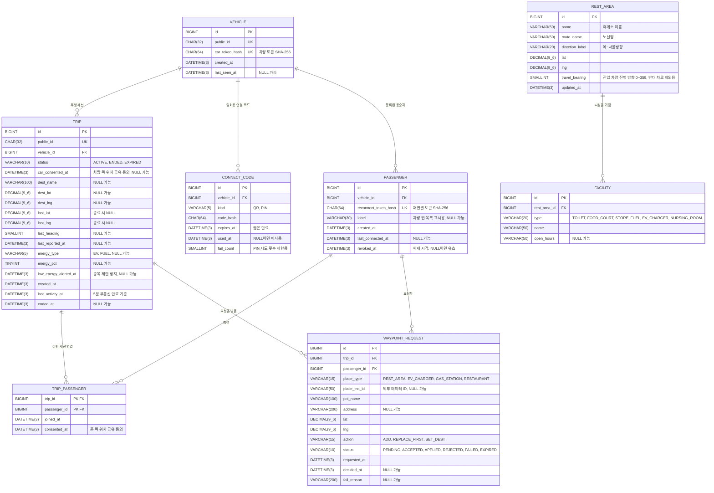

# WAY:ON ERD

> 기준: `docs/changed.md` 4장 (WAY:ON 기획서 반영). 변경 이유는 changed.md에 있습니다.
> DB: MySQL 8.4, utf8mb4, 시간은 모두 UTC
> DDL: `server/src/main/resources/db/schema.sql` (이 문서와 같은 구조. 테이블·컬럼 한글 이름은 `COMMENT`에 있음)



> Mermaid 문법상 타입 안의 쉼표를 쓸 수 없어서 `DECIMAL(9,6)`을 `DECIMAL(9_6)`으로 표기했습니다.

## 테이블 요약

| 테이블 | 한 행의 의미 | 성격 |
|---|---|---|
| `vehicle` | 차량 앱 설치 1개 | 등록 데이터. 차량 토큰 해시 보관 |
| `passenger` | 차량에 등록된 동승자 1명 | 등록 데이터. 자동 재연결용. 차량 앱에서 해제할 때까지 |
| `connect_code` | 일회용 연결 코드 1개 (QR 토큰 또는 4자리 코드) | 임시 데이터. 사용·만료되면 삭제 |
| `trip` | 주행 세션 1건 (차 1대 ↔ 동승자 폰들) | 운행 데이터. 종료·만료 시 위치·목적지·에너지 값 삭제 |
| `trip_passenger` | 세션에 연결된 동승자 1명과 위치 공유 동의 | 운행 데이터 |
| `waypoint_request` | 동승자의 경유지 요청 1건과 운전자 결정 | 운행 데이터. 요청 당시 장소 정보를 그대로 저장 |
| `rest_area` | 휴게소 1곳의 한 방향 (상·하행은 각각 1행) | 기준 데이터. seed.sql로 입력, 서버 시작 때 메모리에 올림 |
| `facility` | 휴게소 안 시설 1개 | 기준 데이터. "충전 가능한 휴게소" 같은 필터용 |

충전소·주유소·맛집은 외부 API(환경부 충전소, 오피넷 등)에서 그때그때 조회하고 DB에 저장하지 않습니다. 빈 충전기, 유가처럼 자주 바뀌는 값이라서입니다.

## 관계

| 관계 | 카디널리티 | 설명 |
|---|---|---|
| vehicle → passenger | 1 : N | 한 차량에 동승자 여러 명 등록 |
| vehicle → connect_code | 1 : N | 연결할 때마다 새 코드 발급 |
| vehicle → trip | 1 : N | 탑승할 때마다 새 세션. ACTIVE 세션은 동시에 1건만 |
| trip ↔ passenger | N : M (`trip_passenger`) | 한 세션에 동승자 여러 명, 한 동승자가 여러 세션에 참여 |
| trip → waypoint_request | 1 : N | 세션 중 요청은 여러 번. 대기(PENDING)는 동시에 1건만 (새 요청이 오면 이전 것은 EXPIRED) |
| passenger → waypoint_request | 1 : N | 요청한 동승자 |
| rest_area → facility | 1 : N | 휴게소 하나에 시설 여러 개 |

## 상태 값

**trip.status**: `ACTIVE` → `ENDED`(차량 앱이 종료) | `EXPIRED`(5분 무통신)

**waypoint_request.status** (허용 전이, design.md 3.4)
```
PENDING  → ACCEPTED | REJECTED | EXPIRED
ACCEPTED → APPLIED  | FAILED
```
10초 무반응 자동 거절은 `EXPIRED`, 운전자가 직접 누른 [거절]은 `REJECTED`로 구분합니다.

**waypoint_request.action**: `ADD`(경유지 추가) | `REPLACE_FIRST`(경유지 2개가 찼을 때 1번과 교체) | `SET_DEST`(목적지가 없을 때 목적지로 설정)

## 인덱스

| 테이블 | 인덱스 | 용도 |
|---|---|---|
| vehicle | `public_id` UNIQUE, `car_token_hash` UNIQUE | 차량 토큰으로 조회 |
| passenger | `reconnect_token_hash` UNIQUE | 재연결 토큰으로 조회 |
| passenger | `idx_passenger_vehicle (vehicle_id, revoked_at)` | 차량 앱의 등록 동승자 목록 |
| connect_code | `idx_cc_lookup (kind, code_hash, expires_at)` | QR·4자리 코드 확인 |
| trip | `public_id` UNIQUE | URL의 tripId로 조회 |
| trip | `idx_trip_vehicle_status (vehicle_id, status)` | 차량의 ACTIVE 세션 조회 |
| trip | `idx_trip_activity (status, last_activity_at)` | 5분 무통신 세션 만료 |
| waypoint_request | `idx_wr_trip_status (trip_id, status)` | 세션의 대기 요청 조회 |
| facility | `idx_facility_ra (rest_area_id)` | 휴게소별 시설 조회 |

## 정해지지 않은 것

- 4자리 코드는 1만 개뿐이라 차량끼리 겹칠 수 있습니다. 동시에 유효한 PIN이 겹치지 않게 발급하거나, 폰에서 차량을 먼저 고르게 해야 합니다 (changed.md 6장 Q2와 함께 결정).
- `passenger`, 끝난 세션의 `waypoint_request` 보관 기간 (changed.md 6장 Q3, Q4).
