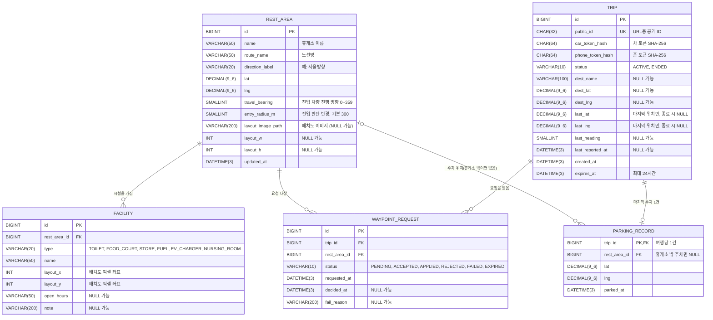

# Co-Pilot Connect ERD

> 기준: `server/src/main/resources/db/schema.sql` (design.md 1.4, 3.5)
> DB: MySQL 8.4, utf8mb4, 시간은 모두 UTC



> Mermaid 문법상 타입 안의 쉼표를 쓸 수 없어서 `DECIMAL(9,6)`을 `DECIMAL(9_6)`으로 표기했습니다.

## 테이블 요약

| 테이블 | 한 행의 의미 | 성격 |
|---|---|---|
| `rest_area` | 휴게소 1곳의 한 방향 (상·하행은 각각 1행) | 기준 데이터. seed.sql로 입력, 서버 시작 때 메모리에 올림 |
| `facility` | 휴게소 안 시설 1개 | 기준 데이터 |
| `trip` | 여행 1건 (차 1대 ↔ 동승자 폰들) | 운행 데이터. 종료 시 위치 삭제 |
| `waypoint_request` | 동승자의 경유지 요청 1건과 운전자 결정 | 운행 데이터 |
| `parking_record` | 여행의 마지막 주차 위치 1건 | 운행 데이터. 종료 시 삭제 |

## 관계

| 관계 | 카디널리티 | 설명 |
|---|---|---|
| rest_area → facility | 1 : N | 휴게소 하나에 시설 여러 개 |
| trip → waypoint_request | 1 : N | 여행 중 요청은 여러 번. 대기(PENDING)는 동시에 1건만 (새 요청이 오면 이전 것은 EXPIRED) |
| rest_area → waypoint_request | 1 : N | 요청 대상 휴게소 |
| trip → parking_record | 1 : 0..1 | 여행당 마지막 주차 위치만 보관 (UPSERT) |
| rest_area → parking_record | 0..1 : N | 휴게소 밖에 주차하면 rest_area_id가 NULL (Q6) |

## 상태 값

**trip.status**: `ACTIVE` → `ENDED`

**waypoint_request.status** (허용 전이, design.md 3.4)
```
PENDING  → ACCEPTED | REJECTED | EXPIRED
ACCEPTED → APPLIED  | FAILED
```

## 인덱스

| 테이블 | 인덱스 | 용도 |
|---|---|---|
| trip | `public_id` UNIQUE | URL의 tripId로 조회 |
| trip | `idx_trip_expires (status, expires_at)` | 만료된 여행 정리 배치 |
| waypoint_request | `idx_wr_trip_status (trip_id, status)` | 여행의 대기 요청 조회 |
| facility | `idx_facility_ra (rest_area_id)` | 휴게소별 시설 조회 |
